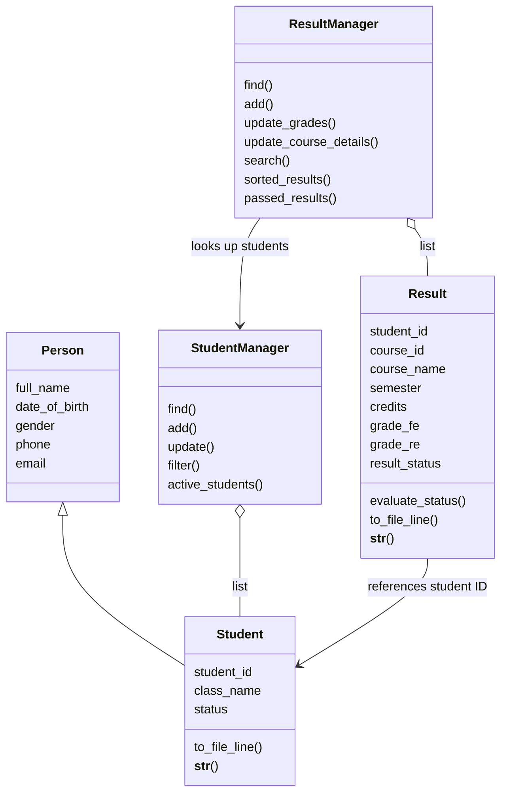

# Student Management System (SMS) - FPT University

A console-based Python project for **PFP191 - Programming Fundamentals with Python**, Topic 4. Class: AI2102. Group: 4. Lecturer: Lê Thị Hồng Nga.

| Student ID | Team member | Responsibilities |
| --- | --- | --- |
| SE211528 | Nguyễn Thái Huy | Team leader, architecture, CLI integration, code review |
| SE211681 | Trần Võ Hồng Ngọc | Student management and validation |
| SE211294 | Vũ Ngọc Anh | Academic result management |
| SE211746 | Nguyễn Thái Sơn | File I/O, exception handling, documentation |

## Project status - October 30, 2026

| Area | Current status |
| --- | --- |
| Lab 4 - Section 4.4 | Models, managers, object collections, shared validation, and CLI integrated; UML and design explanations available |
| Lab 5 - Section 4.5 | Basic File I/O implemented; comprehensive error testing, test reports, and safer persistence remain |
| Sample data | 4 students and 4 results; results use all 8 columns; PFP191 and MAE101 are in Fall2026 with 3 credits each |
| Team learning materials | UML, 95 flowcharts, explanations for 13 Python files, and an animated learning website with 8 lessons and 58 scenes |
| Final deliverables | REPORT.pdf and SLIDES.pptx are not yet complete |

See [project progress and remaining work](docs/PROJECT_PROGRESS.md). The Lab 4 implementation is complete within the team's agreed scope; submission and assessment follow the lecturer's instructions.

Reference materials in this repository:

- [Topic 4 assignment](docs/references/Project_Assignment_Final_PFP191_Topic4.pdf): required data, features, and deliverables.
- [CT/PBL student guidelines](docs/references/3.%20Huong_Dan_Sinh_Vien_PBL_CT.pdf): Section 4.4 covers modules/classes, Section 4.5 covers File I/O and testing, and Section 4.6 covers the report.
- [Course syllabus](docs/references/1.%20Syllabus%20PFP191_PBL_FA26.xlsx): schedule and assessment rubrics. The schedule names Lab 04 “OOP and Collections” and Lab 05 “File and Testing,” while the rubric names them “Data Structures & Functions” and “OOP & Files.” The current design covers modules, reusable functions, collections, and classes.
- [OOP Part 1](docs/references/Pythonlearn-11-%20Object-oriented%20programming-Part%201.pptx) and [OOP Part 2](docs/references/Pythonlearn-11-%20Object-oriented%20programming-Part%202.pptx): classes, objects, encapsulation, abstraction, inheritance, overriding, properties, and lists of objects.

## Running the application

Python 3 is required; Python 3.10 or later is recommended. The CLI uses only the Python standard library.

```powershell
python main.py
```

Data paths are resolved relative to main.py. The main menu provides Student Management, Result Management, and Save and Exit. Changes remain in memory until saving. Ctrl+C or EOF also triggers a save attempt. If saving fails, the application reports the error and returns to the menu so the user can retry.

## Project structure and responsibilities

```text
Student-Management-System-Fptu/
├── main.py                   # Manager initialization, navigation, save/exit
├── student_management.py     # Student management menu
├── result_management.py      # Result management menu
├── file_io.py                # Object persistence using text files
├── models/
│   ├── __init__.py
│   ├── person.py             # Shared personal information
│   ├── student.py            # Student(Person), ID, class, status
│   └── result.py             # Course details, FE/RE, computed result status
├── services/
│   ├── __init__.py
│   ├── student_manager.py    # Student collection, search/add/update/filter
│   └── result_manager.py     # Result collection and student relationships
├── utils/
│   ├── __init__.py
│   └── validator.py          # Shared validation for models and CLI
├── students.txt              # Student records
├── results.txt               # Academic results
├── docs/
│   ├── README.md             # Documentation index
│   ├── PROJECT_PROGRESS.md   # Lab 4/5 progress
│   ├── references/           # Assignment, guidelines, syllabus, course slides
│   ├── diagrams/             # PDF diagrams
│   ├── guides/               # UML, flowcharts, line-by-line explanations
│   └── learning-web/         # Code Atlas website source
│       ├── README.md         # Website features and local setup
│       └── dist/             # HTML/CSS/JS and bundled learning materials
└── README.md
```

Data flows from files to objects, then to managers and menus. When saving, managers provide their object collections to file_io. Menus handle input and output; managers do not call input(). Business operations use objects rather than dictionaries. The to_dict() methods provide an optional representation for inspecting or comparing data.

## Features and business rules

- **Student management:** add students with unique IDs; update all profile fields except the ID; filter by exact class or status without case sensitivity; display Active students or the complete list.
- **Result management:** add results only for existing Active students; reject duplicate `(student_id, course_id)` pairs; search by student ID; sort Pass before Fail before ungraded records; filter passed course records.
- **Result fields:** student_id, course_id, course_name, semester, credits, grade_fe, grade_re, and result_status.
- **Grade updates:** only Active students can have grades changed. Replacing grades with blank input clears them. A blank FE or FE >= 5 clears RE. The menu requests RE only when FE < 5. Course details can also be updated for Inactive or Graduated students to complete historical records without changing grades.
- **Grade representation:** float values from 0 to 10, or None when ungraded. Decimal commas are accepted. Grades are not rounded before evaluation. Missing FE produces status None, displayed by the CLI as “Chưa có điểm” (“Not graded”). FE >= 5, or FE < 5 with RE >= 5, produces Pass; otherwise the result is Fail. Result contains the single evaluation formula.
- **Course details:** credits must be a positive integer. Course name and semester are required for new records and cannot contain delimiters or line breaks. There are no separate Course or Semester classes.
- **Passed results:** the output contains passed course records, not a deduplicated student list. Result status is derived from grades and cannot be edited independently.

Validation is shared between CLI input functions and model constructors/property setters:

| Field | Current rule |
| --- | --- |
| Student ID | One of the team's 16 allowed prefixes followed by 6 ASCII digits; normalized to uppercase |
| Full name | At least 2 letters; spaces, hyphens, and apostrophes allowed; whitespace normalized and title case applied |
| Date of birth | Valid DD/MM/YYYY date, year 1900-2008, not in the future |
| Gender | Male or Female |
| Class | 2 ASCII letters + 4 digits, or 3 ASCII letters + 3 digits |
| Phone | 10 ASCII digits starting with 0 |
| Email | Local-part/domain validation; domains outside fpt.edu.vn are accepted |
| Student status | Active, Inactive, or Graduated |
| Course ID | 2-10 ASCII letters/digits; normalized to uppercase |

The prefix list, birth-year limit, class format, and Active-only grade updates are existing team rules; not all are explicit assignment requirements. Entering 0 at supported ID prompts cancels the operation and returns None. Cancellation is not available at every field.

## UML and Lab 4 concepts



- **Encapsulation:** internal `_...` attributes and properties control updates. Student IDs and result identifiers are read-only through their properties. A leading underscore is a Python convention, not an absolute security boundary.
- **Inheritance:** Student reuses Person initialization through super().
- **Overriding:** Person and Student define their own __str__ methods, so str() uses the representation of the actual object.
- **Abstraction and modular design:** menus call manager methods; managers handle data without depending on console input.
- **Collections:** lists hold Student and Result objects. Loops search/filter, append adds records, and sorted returns ordered results. Collection properties return shallow list copies, preventing callers from directly adding/removing entries in the internal list; the contained objects are still shared.
- **Reuse:** constructors, setters, and input functions call shared validators. Only Result decides Pass/Fail.

The management application remains a Python CLI, with no added framework, database, GUI, abstract base class, design pattern, GPA calculation, delete feature, or extra parent class. Code Atlas under docs/ is a separate interactive learning resource; it neither replaces the CLI nor reads/writes actual student data. File/path handling, exceptions, and unittest support integration and verification; business logic stays within the course's basic Python/OOP scope.

## Data files and backward compatibility

Files use UTF-8, pipe delimiters, and no header. The schemas for students.txt and results.txt respectively are:

```text
student_id|full_name|date_of_birth|gender|class_name|phone|email|status
student_id|course_id|course_name|semester|credits|grade_fe|grade_re|result_status
```

The result loader also accepts the old 5-column format. Missing course name, semester, and credits are kept as None with a notification, rather than guessed. Use Result Management -> Update result -> Update course details to complete a record. Saving writes the 8-column format; missing metadata, grades, or status are written as empty fields.

The current results.txt already uses 8 columns. PFP191 and MAE101 are both in Fall2026 with 3 credits each. Course names, semester, and credits were checked against the FAP screenshots supplied by the team. FE/RE scores are assignment sample data, not grades imported from FAP.

New records must include complete course details. Historical files with missing metadata can still be loaded and displayed. Stored result status is recalculated from grades rather than trusted as user-entered data.

Invalid file structure, invalid data, or read errors stop startup without overwriting the files. Managers check duplicate keys and student references during loading. The writer prepares serialized lines before opening the destination and uses with open to close the file.

**Current limitations:**

- Files are overwritten directly and saved separately, without a transaction. An interrupted write or power failure can cause data loss. There is no automatic backup or temporary-file replacement.
- Semester validation currently checks text only, not the Spring/Summer/Fall + year format.
- Credits must currently be greater than zero; zero-credit courses shown on FAP are not supported.
- The result key is student ID + course ID; separate attempts for the same course in different semesters are not supported.
- Comprehensive file-error tests and a formal test report remain part of Lab 5.

## Verification and next steps

Ten Lab 4 tests were run, covering inheritance/properties, student add/update/filter/duplicate handling, grade boundaries, result add/update/duplicates, status ordering, student relationships, failed grade updates preserving previous values, input contracts, legacy files and object round-trips, and CLI add/update/save/reload behavior. Tests used temporary data. One-time test scripts were removed at the team's request.

Lab 5 still needs tests for missing files, invalid encoding/structure, write permissions, partial save failures, orphaned/duplicate records, Ctrl+C, and failed saves. Record Expected/Actual/Pass-Fail outcomes and screenshots, and improve persistence safety. Final deliverables also include REPORT.pdf and SLIDES.pptx under Section 4.6 and the assignment. An AI Audit Log is optional; the final project rubric allows a bonus of up to 1 point for documented, substantive reflection.

## Animated code-learning website

Open [Code Atlas - Data in Motion](https://sms-code-atlas-ai2102.dewyseed18.chatgpt.site/#cinema). The website is private and requires an authorized ChatGPT account.

- **8 animated lessons / 58 scenes:** student creation, list search with a for loop, adding results, updating grades, None versus zero, sorting/filtering, saving/loading files, and handling invalid input.
- Moving data cards, before/after values, explanations, and source lines are synchronized. Playback supports pause/resume, scene navigation, speed control, and focus mode.
- Interactive UML for 5 classes and 95 flowcharts with step-by-step playback and branch selection.
- Annotated views of 13 files / 838 Python lines, with search and automatic line-by-line reading.

To run the website locally from the project root:

```powershell
python -m http.server 4173 --directory docs/learning-web/dist
```

Open [http://localhost:4173/#cinema](http://localhost:4173/#cinema). The website uses HTML/CSS/JavaScript and requires no npm install to run. Mermaid is bundled; fallback fonts are used if Google Fonts cannot load.

The website presents a source snapshot from October 30, 2026. It illustrates behavior without executing Python. After Python changes, update the website's data and documents to keep line numbers and animations aligned with the source. See the [Code Atlas README](docs/learning-web/README.md) for details. The learning website and supporting team guides are in Vietnamese.

## Team learning materials

All supporting materials are organized under [docs/](docs/README.md):

| Material | Location |
| --- | --- |
| Assignment, CT/PBL guidelines, syllabus, and OOP slides | [references/](docs/references/) |
| PDF diagrams | [diagrams/](docs/diagrams/) |
| Suggested reading order and team learning roles | [Code-reading guide](docs/guides/HUONG_DAN_DOC_CODE.md) |
| Detailed UML, interactions, and OOP concepts | [UML and architecture](docs/guides/01_UML_KIEN_TRUC.md) |
| Function/method flowcharts | [Flowcharts](docs/guides/02_FLOWCHART.md) |
| Line-by-line annotations and Python syntax | [Code explanations](docs/guides/03_GIAI_THICH_TUNG_DONG.md) |
| Progress and remaining work | [PROJECT_PROGRESS.md](docs/PROJECT_PROGRESS.md) |
| Website source and local setup | [learning-web/](docs/learning-web/README.md) |

The guides document the current code and its limitations without adding explanatory comments to Python source. The files under learning-web/dist/documents/ are bundled copies used by the website's document download links.
