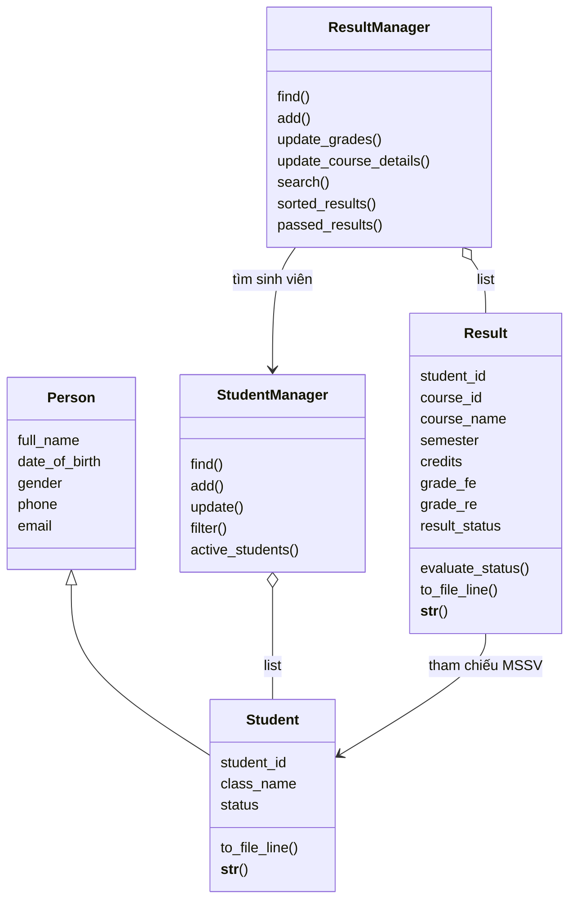

# Student Management System (SMS) - FPT University

[English](../README.md) | **Tiếng Việt**

Bài tập lớn PFP191, Topic 4, lớp AI2102, nhóm 4. Giảng viên: Lê Thị Hồng Nga.

| MSSV | Thành viên | Phân công ghi nhận |
| --- | --- | --- |
| SE211528 | Nguyễn Thái Huy | Nhóm trưởng, kiến trúc, CLI, review |
| SE211681 | Trần Võ Hồng Ngọc | Sinh viên, validation |
| SE211294 | Vũ Ngọc Anh | Kết quả học tập |
| SE211746 | Nguyễn Thái Sơn | File I/O, ngoại lệ, tài liệu |

## Trạng thái ngày 30/10/2026

| Hạng mục | Trạng thái hiện tại |
| --- | --- |
| Lab 4 — mục 4.4 | Đã tích hợp model, manager, collection object, validation dùng chung và CLI; có UML và tài liệu giải thích |
| Lab 5 — mục 4.5 | Đã có File I/O cơ bản; còn kiểm thử lỗi đầy đủ, báo cáo kết quả và cải thiện an toàn lưu |
| Dữ liệu mẫu | 4 sinh viên, 4 kết quả; kết quả đủ 8 cột, hai môn PFP191/MAE101 cùng Fall2026, mỗi môn 3 tín chỉ |
| Tài liệu học nhóm | Đã có UML, 95 flowchart, giải thích 13 file Python và web animation 8 bài / 58 cảnh |
| Sản phẩm cuối kỳ | Chưa hoàn thành REPORT.pdf và SLIDES.pptx |

Xem [tiến độ và phần việc còn lại](PROJECT_PROGRESS.md). Lab 4 đã hoàn thành phần triển khai trong phạm vi nhóm thống nhất; việc đánh giá/nộp bài theo giảng viên.

Tài liệu đối chiếu trong repository:

- [Project_Assignment_Final_PFP191_Topic4.pdf](references/Project_Assignment_Final_PFP191_Topic4.pdf): dữ liệu, chức năng và sản phẩm bàn giao.
- [3. Huong_Dan_Sinh_Vien_PBL_CT.pdf](references/3.%20Huong_Dan_Sinh_Vien_PBL_CT.pdf): mục 4.4 tổ chức module/class; 4.5 File I/O & Testing; 4.6 báo cáo.
- [1. Syllabus PFP191_PBL_FA26.xlsx](references/1.%20Syllabus%20PFP191_PBL_FA26.xlsx): lịch học và rubric. Lịch học gọi Lab 04 là OOP and Collections, Lab 05 là File and Testing; bảng rubric dùng tên Lab 4 Data Structures & Functions và Lab 5 OOP & Files. Thiết kế hiện tại bao phủ module, hàm tái sử dụng, collection và class.
- Hai slide [OOP Part 1](references/Pythonlearn-11-%20Object-oriented%20programming-Part%201.pptx) và [OOP Part 2](references/Pythonlearn-11-%20Object-oriented%20programming-Part%202.pptx): class/object, encapsulation, abstraction, kế thừa, overriding, property, list chứa object.

## Chạy chương trình

Cần Python 3, khuyến nghị 3.10 trở lên. Không cần package ngoài.

```powershell
python main.py
```

Đường dẫn dữ liệu được tính theo thư mục chứa main.py. Menu chính gồm sinh viên, kết quả và Save and Exit. Thay đổi ở trong bộ nhớ tới lúc lưu/thoát; Ctrl+C/EOF cũng thử lưu. Lưu thất bại sẽ báo lỗi và quay lại menu để thử lại.

## Cấu trúc và trách nhiệm

```text
Student-Management-System-Fptu/
├── main.py                   # Khởi tạo manager, điều hướng menu, lưu/thoát
├── student_management.py     # Menu sinh viên
├── result_management.py      # Menu kết quả
├── file_io.py                # Đọc/ghi object bằng file văn bản
├── models/
│   ├── __init__.py
│   ├── person.py             # Thông tin cá nhân dùng chung
│   ├── student.py            # Student(Person), MSSV/lớp/status
│   └── result.py             # Môn học, FE/RE, property xét kết quả
├── services/
│   ├── __init__.py
│   ├── student_manager.py    # Danh sách Student, tìm/thêm/sửa/lọc
│   └── result_manager.py     # Danh sách Result, liên kết sinh viên
├── utils/
│   ├── __init__.py
│   └── validator.py          # Validation dùng chung cho model và CLI
├── students.txt              # Dữ liệu sinh viên
├── results.txt               # Dữ liệu kết quả
├── docs/
│   ├── README.md             # Mục lục tài liệu
│   ├── README.vi.md          # Bản README tiếng Việt
│   ├── PROJECT_PROGRESS.md   # Tiến độ Lab 4/5
│   ├── references/           # Đề bài, hướng dẫn, syllabus, slide môn học
│   ├── diagrams/             # Sơ đồ PDF
│   ├── guides/               # UML, flowchart, giải thích từng dòng
│   └── learning-web/         # Source web Code Atlas
│       ├── README.md         # Cách chạy web và mô tả tính năng
│       └── dist/             # HTML/CSS/JS và tài liệu đóng gói của web
└── README.md

```

Luồng: file -> object -> manager -> menu; khi lưu, manager cung cấp danh sách object cho file_io. Menu phụ trách input/print; manager không gọi input. Dữ liệu nghiệp vụ không còn chạy bằng dictionary. `to_dict()` chỉ là cách biểu diễn object khi cần đối chiếu dữ liệu.

## Chức năng và quy tắc

- Sinh viên: thêm không trùng MSSV; sửa thông tin trừ MSSV; lọc chính xác theo lớp/status không phân biệt hoa thường; hiển thị Active và toàn bộ.
- Kết quả: thêm khi sinh viên tồn tại và Active; chặn trùng `(student_id, course_id)`; tìm theo MSSV; sắp xếp Pass, Fail rồi chưa có điểm; lọc bản ghi Pass.
- Đủ trường Result: student_id, course_id, course_name, semester, credits, grade_fe, grade_re, result_status.
- Sửa điểm chỉ cho Active. Thay thế FE/RE: nhập trống xóa điểm; FE trống hoặc >=5 sẽ xóa RE. FE <5 mới cho nhập RE. Chỉnh thông tin môn được phép cả với sinh viên Inactive/Graduated để bổ sung dữ liệu lịch sử mà không sửa điểm.
- Điểm là float trong khoảng 0–10 hoặc None, chấp nhận dấu phẩy thập phân; không làm tròn trước xét kết quả. FE chưa có -> status None, hiển thị “Chưa có điểm”. FE>=5 hoặc FE<5 và RE>=5 -> Pass; còn lại Fail. Công thức duy nhất ở Result.
- Credits là số nguyên dương. Tên môn/học kỳ bắt buộc khi thêm mới, không chứa dấu phân cách hoặc ký tự xuống dòng. Chưa tạo Course/Semester thành class riêng.
- Kết quả Pass là danh sách bản ghi môn đạt, không gộp sinh viên duy nhất. Status được tính từ điểm, không sửa tay độc lập.

Validation dùng chung cho CLI và constructor/property:

| Trường | Quy tắc |
| --- | --- |
| MSSV | Prefix trong danh sách 16 mã của nhóm + 6 số ASCII, chuẩn hóa hoa |
| Tên | Ít nhất 2 chữ cái; cho phép khoảng trắng, gạch nối, dấu nháy; chuẩn hóa khoảng trắng và title |
| Ngày sinh | DD/MM/YYYY, ngày thật, năm 1900–2008, không tương lai |
| Giới tính | Male/Female |
| Lớp | 2 chữ + 4 số hoặc 3 chữ + 3 số ASCII |
| Điện thoại | 10 số ASCII bắt đầu bằng 0 |
| Email | Kiểm tra local/domain, chấp nhận domain ngoài fpt.edu.vn |
| Status sinh viên | Active/Inactive/Graduated |
| Mã môn | 2–10 chữ/số ASCII, chuẩn hóa hoa |

Các quy tắc prefix, năm sinh đến 2008, định dạng lớp và chỉ Active sửa điểm được giữ từ lựa chọn của nhóm; không coi tất cả là yêu cầu nguyên văn của đề. Hủy ở bước nhập mã dùng 0 và trả None. Chưa hỗ trợ hủy ở mọi trường.

## UML và kiến thức Lab 4



- Encapsulation: thuộc tính `_...`, property kiểm soát cập nhật; mã sinh viên/môn chỉ đọc qua property. Dấu `_` là quy ước nội bộ của Python, không phải cơ chế bảo mật tuyệt đối.
- Kế thừa: Student gọi constructor Person bằng super().
- Overriding: Person và Student có __str__ riêng; gọi str() dùng cách biểu diễn của object tương ứng.
- Abstraction/modular design: menu gọi method manager; manager quản lý dữ liệu mà không phụ thuộc nhập console.
- Collections: list chứa Student/Result; dùng vòng lặp tìm/lọc, append thêm, sorted sắp xếp. Property danh sách trả bản sao để bên gọi không xóa/thêm trực tiếp vào list nội bộ.
- Tái sử dụng: constructor/setter và hàm nhập gọi chung validator; chỉ Result quyết định Pass/Fail.

Ứng dụng quản lý vẫn là Python CLI; không thêm framework, database, GUI, abstract base class, design pattern, GPA, chức năng xóa hay lớp cha mới. Web Code Atlas trong docs/ là tài liệu học tương tác riêng, không thay thế CLI và không đọc/ghi dữ liệu sinh viên thật. File/path, ngoại lệ và unittest chỉ phục vụ nối chương trình và kiểm chứng; phần triển khai nghiệp vụ dùng kiến thức Python cơ bản/OOP trong bài học.

## File dữ liệu và tương thích bản cũ

UTF-8, phân cách bằng `|`, không có header:

```text
student_id|full_name|date_of_birth|gender|class_name|phone|email|status
student_id|course_id|course_name|semester|credits|grade_fe|grade_re|result_status
```

Loader đọc cả kết quả 5 cột cũ. Ba trường thiếu được giữ None và thông báo rõ, không đoán tên môn/học kỳ/tín chỉ. Vào Result Management -> Update result -> Update course details để bổ sung từng bản ghi. Khi lưu, kết quả được xuất thành 8 cột; các trường còn thiếu và điểm/status None thành ô trống. Dữ liệu results.txt hiện đã chuyển sang 8 cột: PFP191 và MAE101 cùng Fall2026, mỗi môn 3 tín chỉ. Tên môn, học kỳ Fall2026 và số tín chỉ đã được đối chiếu với ảnh FAP do nhóm cung cấp. Các điểm FE/RE trong file là dữ liệu mẫu bài tập, không phải điểm lấy từ FAP.

Bản ghi thêm mới phải đủ thông tin môn. Các file lịch sử thiếu metadata vẫn tải/hiển thị được; dữ liệu mẫu hiện tại đã đủ ba trường thông tin môn. Status trong file được tính lại từ điểm, không tin giá trị status nhập tay.

Nếu cấu trúc/dữ liệu không hợp lệ hoặc lỗi đọc, chương trình dừng khởi động và không lưu đè file. Manager kiểm tra trùng mã và MSSV tham chiếu khi tải. Writer tạo nội dung trước khi mở file và dùng with open để đóng file.

**Giới hạn hiện tại:**

- Vẫn ghi đè trực tiếp; hai file không lưu như một giao dịch. Lỗi ghi giữa chừng hoặc mất điện có thể làm mất dữ liệu. Chưa có backup tự động/file tạm thay thế.
- Học kỳ hiện chỉ kiểm tra văn bản, chưa bắt mẫu Spring/Summer/Fall + năm.
- Tín chỉ đang yêu cầu số nguyên > 0, chưa hỗ trợ các môn 0 tín chỉ trên FAP.
- Khóa kết quả là MSSV + mã môn; chưa lưu riêng cùng môn ở nhiều học kỳ.
- Kiểm thử lỗi file đầy đủ và báo cáo kiểm thử còn thuộc Lab 5.

## Kiểm chứng và bước tiếp theo

Đã chạy 10 kiểm thử Lab 4: kế thừa/property, sinh viên thêm/sửa/lọc/trùng mã, biên điểm, kết quả thêm/sửa/trùng, thứ tự status, liên kết sinh viên, cập nhật lỗi không đổi điểm cũ, hợp đồng nhập, đọc file 5 cột và round-trip object, luồng CLI thêm/sửa/lưu/tải lại. File dùng cho kiểm thử ở thư mục tạm; script kiểm thử đã xóa theo yêu cầu nhóm.

Lab 5 cần: test file thiếu/sai encoding/sai cấu trúc/quyền ghi, lỗi một trong hai file, dữ liệu mồ côi/trùng, Ctrl+C và lưu thất bại; lập bảng Expected/Actual/Pass-Fail và ảnh minh chứng; cải thiện an toàn lưu phù hợp. Sản phẩm cuối kỳ còn REPORT.pdf và SLIDES.pptx theo mục 4.6/đề bài. AI Audit Log là tùy chọn, rubric nêu thưởng tối đa 1 điểm nếu có bằng chứng phản biện thực tế.

## Web animation học code

Mở [Code Atlas — Xem dữ liệu chuyển động](https://sms-code-atlas-ai2102.dewyseed18.chatgpt.site/#cinema). Web hiện riêng tư, cần đăng nhập bằng tài khoản ChatGPT được cấp quyền.

- **8 bài phim / 58 cảnh:** tạo sinh viên, vòng for tìm kiếm, thêm điểm, sửa điểm, None so với 0, sắp xếp/lọc, lưu–đọc file và xử lý nhập sai.
- Thẻ dữ liệu di chuyển giữa các bước; bảng giá trị trước/sau, lời giải thích và dòng source được đồng bộ. Có phát/dừng, chuyển cảnh, chỉnh tốc độ và chế độ tập trung.
- UML 5 class tương tác; 95 flowchart chạy từng bước và chọn nhánh.
- 13 file / 838 dòng Python có chú giải, tìm kiếm và chế độ đọc tự động.

Chạy web tại máy từ thư mục gốc dự án:

```powershell
python -m http.server 4173 --directory docs/learning-web/dist
```

Mở [http://localhost:4173/#cinema](http://localhost:4173/#cinema). Web dùng HTML/CSS/JavaScript, không cần npm install để chạy. Mermaid được đóng gói sẵn; font có phương án dự phòng khi không tải được Google Fonts.

Web là bản chụp source ngày 30/10/2026, mô phỏng để học và không thực thi Python thật. Khi sửa mã Python, cần cập nhật dữ liệu/tài liệu của web để giữ số dòng và minh họa khớp source. Chi tiết tại [README của Code Atlas](learning-web/README.md).

## Tài liệu học nhóm

Toàn bộ tài liệu được gom vào [docs/](README.md):

| Nội dung | Đường dẫn |
| --- | --- |
| Đề bài, hướng dẫn CT/PBL, syllabus, hai slide OOP | [references/](references/) |
| Sơ đồ PDF | [diagrams/](diagrams/) |
| Thứ tự đọc và phân công học nhóm | [Hướng dẫn đọc code](guides/HUONG_DAN_DOC_CODE.md) |
| UML chi tiết, luồng tương tác và kiến thức OOP | [UML và kiến trúc](guides/01_UML_KIEN_TRUC.md) |
| Sơ đồ từng hàm/method | [Flowchart](guides/02_FLOWCHART.md) |
| Chú giải theo số dòng và cú pháp Python | [Giải thích từng dòng](guides/03_GIAI_THICH_TUNG_DONG.md) |
| Tiến độ và phần việc còn lại | [PROJECT_PROGRESS.md](PROJECT_PROGRESS.md) |
| Source và hướng dẫn web animation | [learning-web/](learning-web/README.md) |

Các hướng dẫn mô tả code hiện tại và các giới hạn, không thêm comment giải thích vào source Python. Tài liệu trong learning-web/dist/documents/ là bản đóng gói phục vụ nút tải tài liệu trên web.
