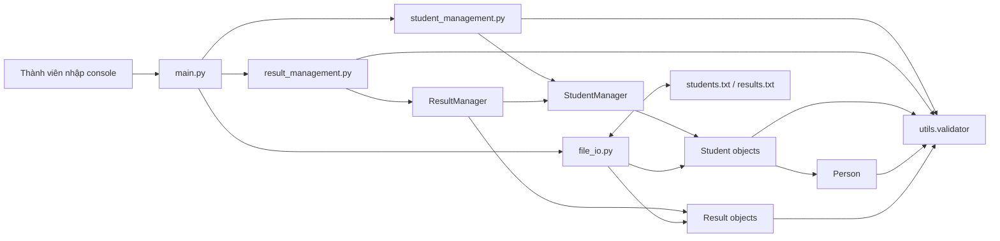
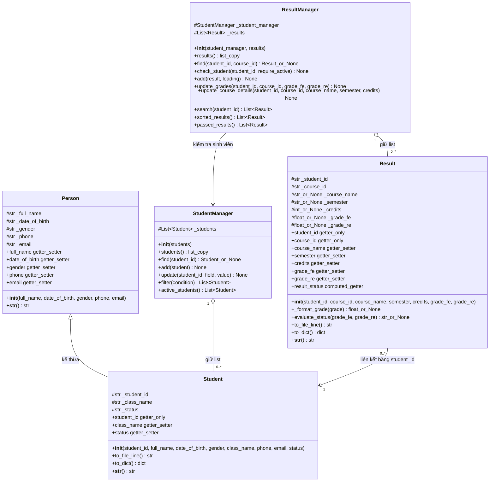
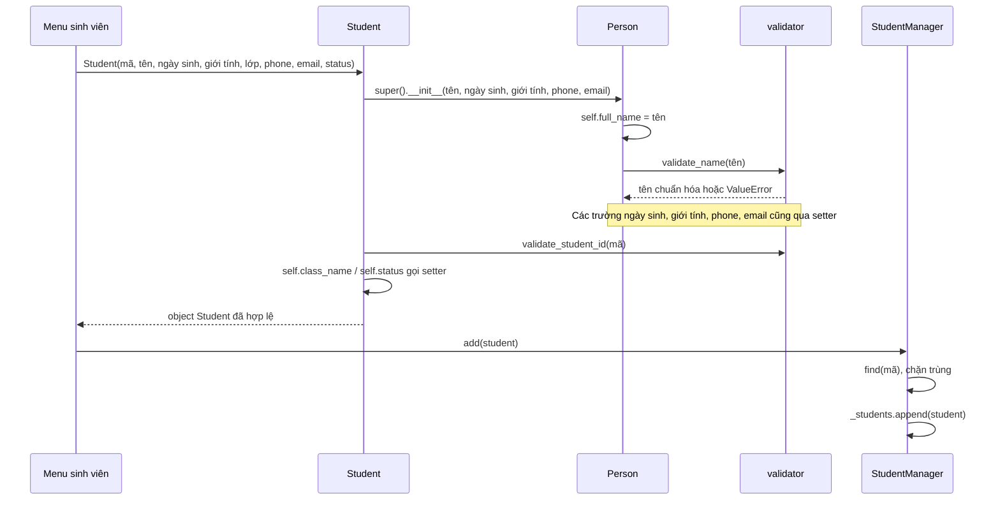
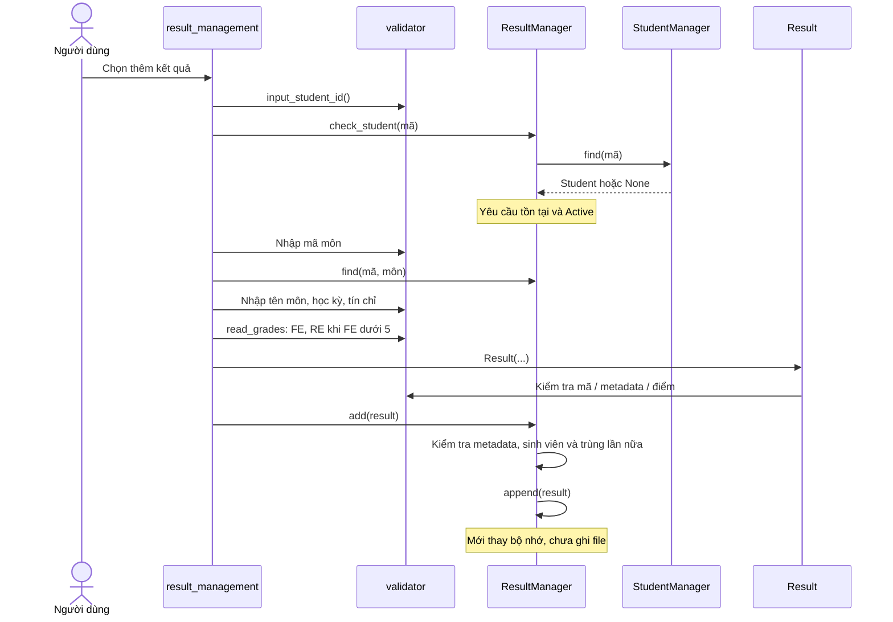
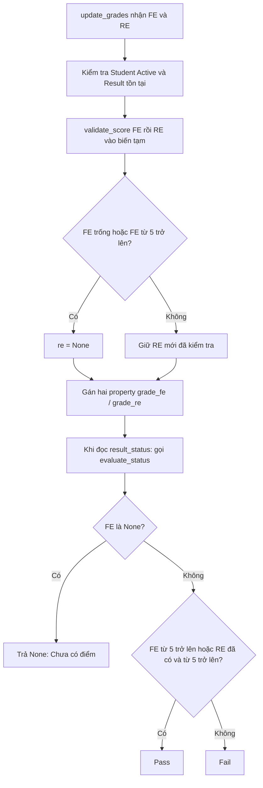

# UML chi tiết và cách đọc kiến trúc

[Quay lại mục lục](HUONG_DAN_DOC_CODE.md)

## 1. Bản đồ toàn dự án

Mũi tên trên là sử dụng/gọi, không phải tất cả đều là kế thừa. UML bên dưới mới thể hiện loại quan hệ class. File I/O tạo object rồi main đưa chúng vào manager. Menu không đọc/ghi file trực tiếp.

## 2. UML class đầy đủ

`+` là giao diện dùng bên ngoài. `#` biểu diễn thuộc tính nội bộ theo quy ước `_` trong code, không phải Python cấm truy cập. `~` trong List~Student~ là cú pháp kiểu generic của Mermaid. `?` trong phần giải thích nghĩa là cho phép None. Kiểu dữ liệu trong sơ đồ là diễn giải để học, không phải type annotation đã có trong source.

Property được ghi getter/setter để dễ nhận diện, không phải method nhận tham số có tên getter_setter. Trong code dùng `student.status`, không dùng `student.status()`. `_format_grade` và `evaluate_status` là staticmethod: không nhận self, có thể gọi `Result.evaluate_status(...)`.

Quan hệ Result -> Student là quan hệ dữ liệu thông qua mã, không có thuộc tính Student object bên trong Result. Chỉ manager bảo đảm mã tham chiếu tồn tại. Dùng aggregation vì các object được tạo trước khi đưa vào manager và vẫn có thể được nơi khác tham chiếu; không khẳng định vòng đời độc quyền như composition.

## 3. Một object Student được tạo như thế nào?

`super()` không tạo một Person độc lập nằm trong Student. Nó chạy constructor lớp cha trên cùng object Student. Các field kế thừa và field riêng đều thuộc object đó.

## 4. Một lần thêm kết quả đi qua đâu?

Đọc đúng thứ tự thực tế ở flowchart/add_result: nhập MSSV -> check_student -> nhập mã môn -> find trùng -> nhập chi tiết môn -> nhập điểm -> tạo Result -> add. Flowchart và giải thích số dòng bên cạnh giúp đối chiếu từng bước.

## 5. Khi sửa điểm, status đổi như thế nào?

Ví dụ: FE=4, RE=5 -> Pass. Đổi FE=6 -> RE bị xóa, vẫn Pass. Đổi FE trống -> FE/RE đều None, status None. Nhập FE=10.04 -> lỗi, không sửa điểm cũ. FE=4.96 vẫn dưới 5 vì không làm tròn. Status None khác chuỗi `"None"` và khác `"Fail"`.

## 6. File, object và chuỗi khác nhau ra sao?

| Giai đoạn | Biểu diễn | Ý nghĩa |
| --- | --- | --- |
| File | `SE211528\|PFP191\|Programming Fundamentals with Python\|Fall2026\|3\|4.0\|5.0\|Pass` | Tất cả là chữ, cột cách nhau bằng dấu phân cách |
| Sau split | list chuỗi `parts` | Cột credits và điểm vẫn chưa phải số |
| Sau Result(...) | credits int=3; FE float=4.0; RE float=5.0 | Constructor/property gọi validator để đổi kiểu |
| Đọc status | property trả `Pass` | Tính lại theo điểm, bỏ status lưu sẵn trong file |
| to_file_line | chuỗi 8 cột + ký tự xuống dòng | None được đổi thành ô trống, không ghi chữ None |
| to_dict | dictionary mới | Hỗ trợ biểu diễn/đối chiếu; không phải dữ liệu nghiệp vụ chính |

Có thể gọi `to_file_line()` trên Student và Result với cùng tên method nhưng cách tạo dòng khác nhau; đây là một ví dụ dùng chung giao diện trên object khác loại. `print(student)` chọn Student.__str__, thay vì Person.__str__ đã được override.

## 7. Những chỗ dễ hiểu nhầm khi vấn đáp

| Code/khái niệm | Cần hiểu đúng |
| --- | --- |
| `_students.copy()` | Chỉ sao chép list; Student bên trong vẫn là object gốc. Xóa phần tử trong bản sao không xóa list manager, nhưng sửa Student sẽ thấy thay đổi ở cả hai nơi |
| `find()` | Trả chính object đang được giữ, không clone object |
| `raise ValueError` | Dừng luồng hiện tại, tìm except phù hợp ở nơi gọi; không tự in lỗi |
| `loading=True` | Bỏ điều kiện Active và đủ metadata khi tải lịch sử, vẫn kiểm tra kiểu Result, MSSV tồn tại và khóa trùng |
| `require_active=False` | Chỉ bỏ kiểm tra Active; không bỏ kiểm tra tồn tại sinh viên |
| `sorted(...)` | Tạo list mới, không sắp xếp lại list nội bộ bằng in-place |
| `or ""` | None trở thành khóa rỗng để so sánh với chuỗi; chưa có điểm xếp sau Fail |
| `Student(*parts)` | Unpack 8 phần tử thành 8 đối số theo thứ tự constructor |
| `reader` trong dictionary menu | Hàm được giữ như một giá trị; `reader(...)` mới thực sự gọi hàm |
| `with open` | Bảo đảm đóng tài nguyên; không bảo đảm ghi nguyên tử hay chống mất điện |
| `__all__` | Danh sách tên xuất qua import *, không phải danh sách hàm phải chạy |
| `if __name__ == "__main__"` | Chỉ tự gọi main khi chạy file trực tiếp; import main không tự chạy menu |

## 8. Giới hạn hiện tại phải giải thích trung thực

- Học kỳ hiện dùng validate_text: chưa bắt buộc mẫu Spring/Summer/Fall + năm.
- Credits đang yêu cầu >0, chưa hỗ trợ môn 0 tín chỉ trong ảnh FAP; hai môn mẫu đều 3 tín chỉ.
- Result riêng lẻ cho phép metadata None để tải file cũ; add mới qua manager yêu cầu đủ metadata.
- Model không tự ép quan hệ FE/RE ở mọi lần gán trực tiếp; menu/manager điều khiển RE. Có thể gán RE vào Result khi FE None; status vẫn None.
- Hai file ghi lần lượt, không có rollback/backup tự động. Nếu một file thành công và file kia lỗi, trạng thái file có thể lệch.
- Khi EOF lặp lại và save liên tục thất bại, main có thể lặp báo lỗi; chưa xử lý đầy đủ tình huống này.
- Điều kiện ngày sinh đến 2008, prefix và Active là quy tắc nhóm giữ từ bản trước; không khẳng định mọi điều kiện đều do đề bắt buộc.
- Khóa kết quả là MSSV + mã môn, chưa hỗ trợ bản ghi riêng cho cùng môn ở nhiều học kỳ.

Các ghi chú trên mô tả code hiện tại, không âm thầm bổ sung tính năng hoặc coi Lab 5 đã hoàn thành.

## 9. Câu hỏi tự kiểm cho mỗi thành viên

1. Vì sao constructor dùng `self.phone = phone` thay vì luôn gán `_phone` trực tiếp?
2. Tại sao đổi mã sinh viên sau khi đã có kết quả là nguy hiểm?
3. Nếu FE sai nhưng file ghi Pass, chương trình sẽ lấy trạng thái nào?
4. Vì sao cùng một điểm được kiểm tra ở input rồi lại ở model?
5. Thêm object vào manager đã lưu xuống đĩa chưa?
6. Tại sao update_grades kiểm tra FE/RE trước khi gán cả hai?
7. File không tồn tại khác file có dữ liệu sai ở đường xử lý nào?
8. Vì sao property danh sách trả copy nhưng chưa phải bảo vệ tuyệt đối object bên trong?

Đáp án nằm lần lượt ở phần constructor/setter, liên kết MSSV, loader/Result, validation dùng chung, luồng lưu, update_grades, File I/O/main và bảng khái niệm phía trên.
