# Flowchart từng hàm và method

[Quay lại mục lục](HUONG_DAN_DOC_CODE.md)

Mỗi ô ghi số dòng L... và thao tác. Hình thoi là điều kiện; cạnh Đúng/Sai thể hiện nhánh. Mũi tên nét đứt biểu diễn đường lỗi, không phải thứ tự thực thi bình thường. Hàm được gọi được mở rộng ở sơ đồ riêng, tránh lặp toàn bộ sơ đồ.

Nếu lỗi không có except phù hợp trong hàm, lỗi truyền về nơi gọi. `with open` tự đóng file kể cả khi return/raise; sơ đồ dùng một ô mở/đóng tài nguyên, không vẽ chi tiết cơ chế Python. Với try, cạnh lỗi tổng quát từ vùng try biểu diễn lỗi có thể xuất hiện ở bất kỳ lệnh/gọi hàm nào bên trong; không có nghĩa chỉ dòng try phát sinh lỗi.


## main.py

Điểm bắt đầu: tải object, khởi tạo manager, điều hướng menu và lưu khi thoát.


### save_data — method/hàm — L12–19

Thử lưu cả hai file, chỉ trả True khi cả hai thành công; không có rollback nếu chỉ một file lưu được.

```mermaid
flowchart TD
    n1(["Trả về nơi gọi"])
    n3["L19: return False"]
    n4["L18: print(&#x27;Save failed. Some data may not have been saved.&#x27;)"]
    n5{"L15: students_ok and results_ok"}
    n6["L17: return True"]
    n7["L16: print(&#x27;Data saved.&#x27;)"]
    n8["L14: results_ok = file_io.save_records(RESULTS_FILE, results.results)"]
    n9["L13: students_ok = file_io.save_records(STUDENTS_FILE, students.students)"]
    n10(["Gọi save_data (L12)"])
    n3 --> n1
    n4 --> n3
    n6 --> n1
    n7 --> n6
    n5 -->|Đúng| n7
    n5 -->|Sai| n4
    n8 --> n5
    n9 --> n8
    n10 --> n9
```


### main — method/hàm — L22–49

Tải Student trước Result để kiểm tra quan hệ; tải lỗi thì dừng, menu lặp đến khi lưu thành công.

```mermaid
flowchart TD
    n1(["Trả về nơi gọi"])
    n2(["Lỗi truyền về nơi gọi"])
    n3{"L31: True"}
    n4["L32: Vùng try"]
    n5{"L36: choice == &#x27;1&#x27;"}
    n6["L37: student_sub_menu(students)"]
    n7{"L38: choice == &#x27;2&#x27;"}
    n8["L39: result_sub_menu(results)"]
    n9{"L40: choice == &#x27;3&#x27;"}
    n10{"L41: save_data(students, results)"}
    n11["L42: return None"]
    n12["L44: print(&#x27;Invalid choice.&#x27;)"]
    n13["L35: choice = input(&#x27;Choice: &#x27;).strip()"]
    n14["L34: print(&#x27;1. Student Management\n2. Result Management\n3. Save and Exit&#x27;)"]
    n15["L33: print(&#x27;\nSTUDENT MANAGEMENT SYSTEM&#x27;)"]
    n16["L45: except (KeyboardInterrupt, EOFError)"]
    n17["L49: print(&#x27;Returning to menu so you can retry saving.&#x27;)"]
    n18{"L47: save_data(students, results)"}
    n19["L48: return None"]
    n20["L46: print(&#x27;\nSaving before exit...&#x27;)"]
    n21["L30: print(f&#x27;Loaded {len(students.students)} students and {len(results.results)} results.&#x27;)"]
    n22["L23: Vùng try"]
    n23["L25: results = ResultManager(students, file_io.load_results(RESULTS_FILE))"]
    n24["L24: students = StudentManager(file_io.load_students(STUDENTS_FILE))"]
    n25["L26: except (OSError, ValueError, UnicodeError)"]
    n26["L29: return None"]
    n27["L28: print(&#x27;Startup stopped; original files have not been changed.&#x27;)"]
    n28["L27: print(&#x27;[Error] Cannot load data:&#x27;, error)"]
    n29(["Gọi main (L22)"])
    n6 --> n3
    n8 --> n3
    n11 --> n1
    n10 -->|Đúng| n11
    n10 -->|Sai| n3
    n12 --> n3
    n9 -->|Đúng| n10
    n9 -->|Sai| n12
    n7 -->|Đúng| n8
    n7 -->|Sai| n9
    n5 -->|Đúng| n6
    n5 -->|Sai| n7
    n13 --> n5
    n14 --> n13
    n15 --> n14
    n4 -->|Bình thường| n15
    n4 -.->|Lỗi phù hợp| n16
    n17 --> n3
    n19 --> n1
    n18 -->|Đúng| n19
    n18 -->|Sai| n17
    n20 --> n18
    n16 --> n20
    n4 -.->|Lỗi khác| n2
    n3 -->|Đúng| n4
    n21 --> n3
    n23 --> n21
    n24 --> n23
    n22 -->|Bình thường| n24
    n22 -.->|Lỗi phù hợp| n25
    n26 --> n1
    n27 --> n26
    n28 --> n27
    n25 --> n28
    n22 -.->|Lỗi khác| n2
    n29 --> n22
```


## models/person.py

Thông tin cá nhân dùng chung. Constructor gọi setter để kiểm tra ngay lúc tạo object.


### __init__ — method/hàm — L7–12

Luồng method/hàm theo đúng các câu lệnh bên dưới; getter đọc giá trị, setter kiểm tra trước khi gán nếu gọi validator.

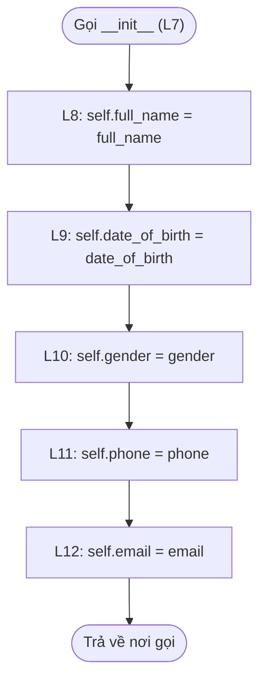


### full_name — getter — L15–16

Luồng getter theo đúng các câu lệnh bên dưới; getter đọc giá trị, setter kiểm tra trước khi gán nếu gọi validator.

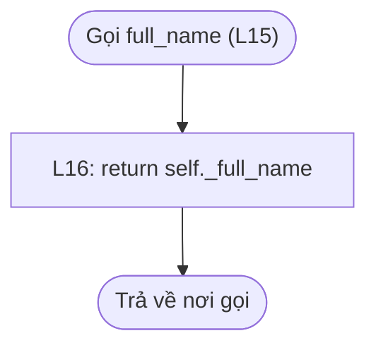


### full_name — setter — L19–20

Luồng setter theo đúng các câu lệnh bên dưới; getter đọc giá trị, setter kiểm tra trước khi gán nếu gọi validator.

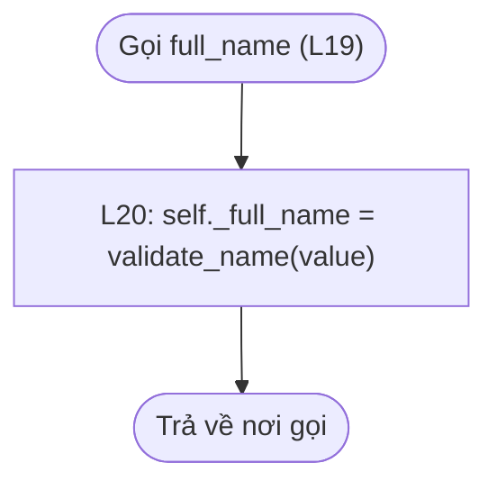


### date_of_birth — getter — L23–24

Luồng getter theo đúng các câu lệnh bên dưới; getter đọc giá trị, setter kiểm tra trước khi gán nếu gọi validator.

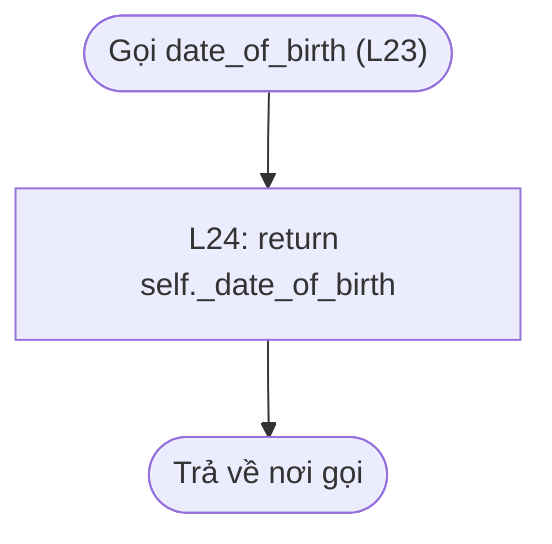


### date_of_birth — setter — L27–28

Luồng setter theo đúng các câu lệnh bên dưới; getter đọc giá trị, setter kiểm tra trước khi gán nếu gọi validator.

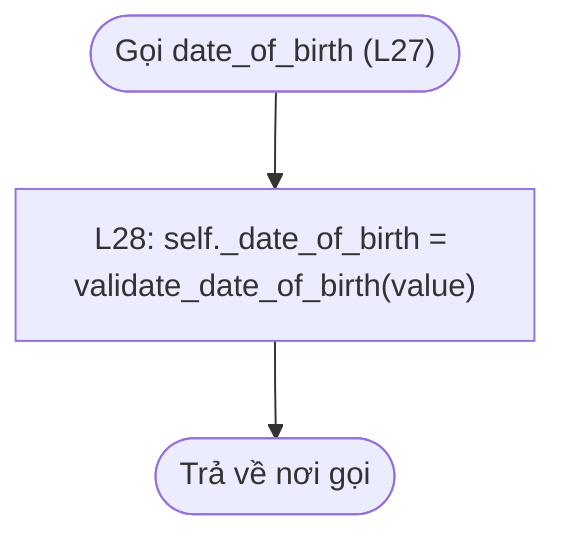


### gender — getter — L31–32

Luồng getter theo đúng các câu lệnh bên dưới; getter đọc giá trị, setter kiểm tra trước khi gán nếu gọi validator.

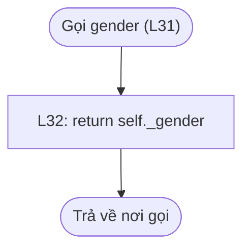


### gender — setter — L35–36

Luồng setter theo đúng các câu lệnh bên dưới; getter đọc giá trị, setter kiểm tra trước khi gán nếu gọi validator.

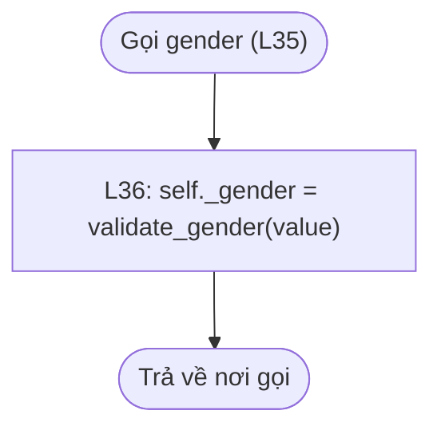


### phone — getter — L39–40

Luồng getter theo đúng các câu lệnh bên dưới; getter đọc giá trị, setter kiểm tra trước khi gán nếu gọi validator.


### phone — setter — L43–44

Luồng setter theo đúng các câu lệnh bên dưới; getter đọc giá trị, setter kiểm tra trước khi gán nếu gọi validator.

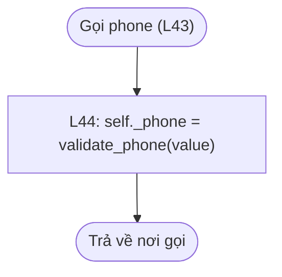


### email — getter — L47–48

Luồng getter theo đúng các câu lệnh bên dưới; getter đọc giá trị, setter kiểm tra trước khi gán nếu gọi validator.

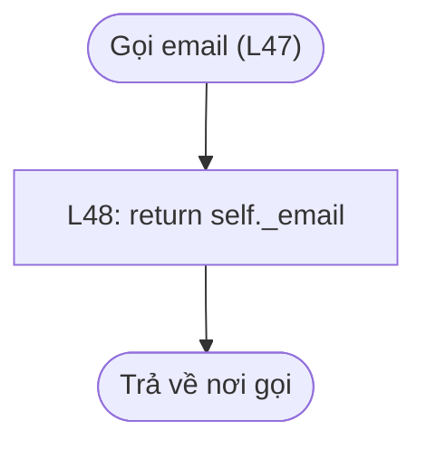


### email — setter — L51–52

Luồng setter theo đúng các câu lệnh bên dưới; getter đọc giá trị, setter kiểm tra trước khi gán nếu gọi validator.

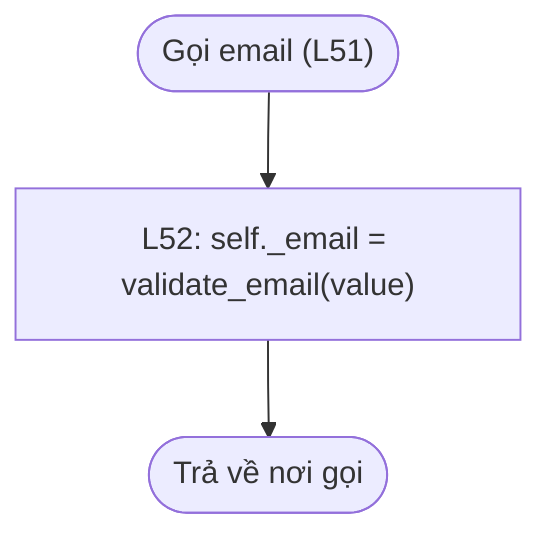


### __str__ — method/hàm — L54–55

Luồng method/hàm theo đúng các câu lệnh bên dưới; getter đọc giá trị, setter kiểm tra trước khi gán nếu gọi validator.

```mermaid
flowchart TD
    n1(["Trả về nơi gọi"])
    n3["L55: return f&#x27;{self._full_name} &#124; {self._date_of_birth} &#124; {self._gender} &#124; {self._phone} &#124; {self._email}&#x27;"]
    n4(["Gọi __str__ (L54)"])
    n3 --> n1
    n4 --> n3
```


## models/student.py

Student kế thừa Person; bổ sung MSSV, lớp, trạng thái. MSSV không có setter.


### __init__ — method/hàm — L9–23

Luồng method/hàm theo đúng các câu lệnh bên dưới; getter đọc giá trị, setter kiểm tra trước khi gán nếu gọi validator.

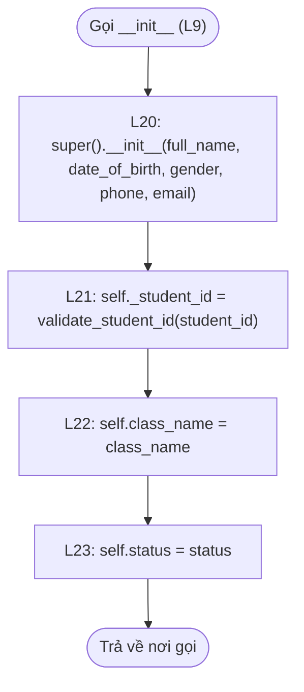


### student_id — getter — L26–27

Luồng getter theo đúng các câu lệnh bên dưới; getter đọc giá trị, setter kiểm tra trước khi gán nếu gọi validator.

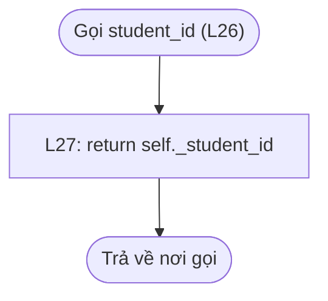


### class_name — getter — L30–31

Luồng getter theo đúng các câu lệnh bên dưới; getter đọc giá trị, setter kiểm tra trước khi gán nếu gọi validator.

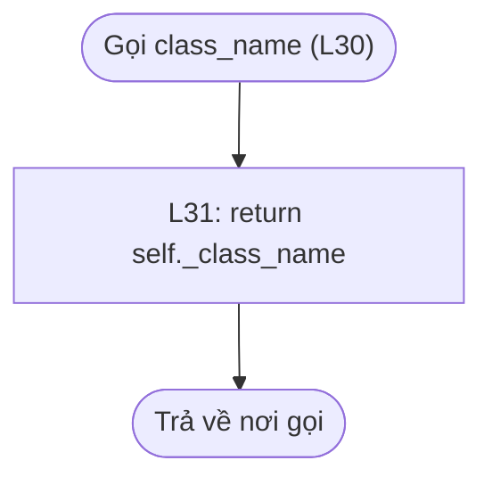


### class_name — setter — L34–35

Luồng setter theo đúng các câu lệnh bên dưới; getter đọc giá trị, setter kiểm tra trước khi gán nếu gọi validator.

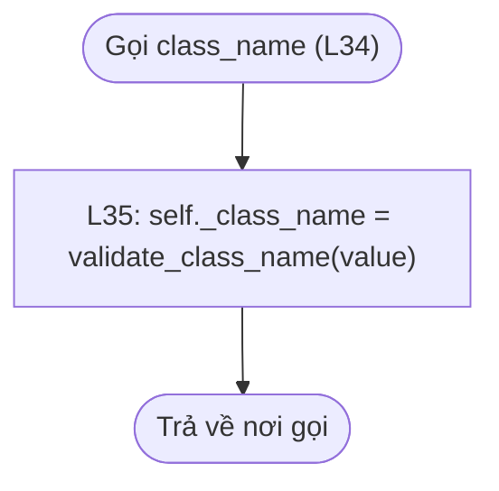


### status — getter — L38–39

Luồng getter theo đúng các câu lệnh bên dưới; getter đọc giá trị, setter kiểm tra trước khi gán nếu gọi validator.

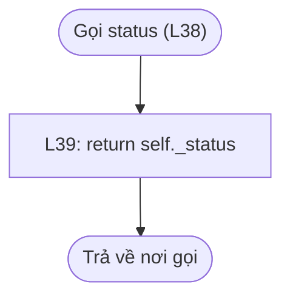


### status — setter — L42–43

Luồng setter theo đúng các câu lệnh bên dưới; getter đọc giá trị, setter kiểm tra trước khi gán nếu gọi validator.

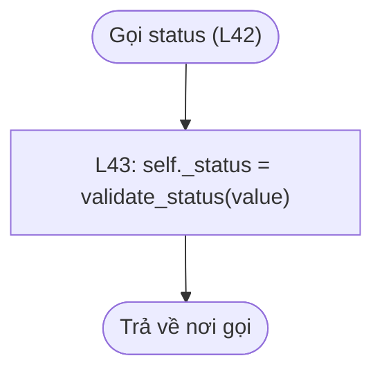


### to_file_line — method/hàm — L45–46

Luồng method/hàm theo đúng các câu lệnh bên dưới; getter đọc giá trị, setter kiểm tra trước khi gán nếu gọi validator.

```mermaid
flowchart TD
    n1(["Trả về nơi gọi"])
    n3["L46: return f&#x27;{self._student_id}&#124;{self._full_name}&#124;{self._date_of_birth}&#124;{self._gender}&#124;{self._class_name}&#124;{self._phone}&#124;{self._email}&#124;{self._status}\n&#x27;"]
    n4(["Gọi to_file_line (L45)"])
    n3 --> n1
    n4 --> n3
```


### to_dict — method/hàm — L48–58

Luồng method/hàm theo đúng các câu lệnh bên dưới; getter đọc giá trị, setter kiểm tra trước khi gán nếu gọi validator.

```mermaid
flowchart TD
    n1(["Trả về nơi gọi"])
    n3["L49: return {&#x27;student_id&#x27;: self._student_id, &#x27;full_name&#x27;: self._full_name, &#x27;date_of_birth&#x27;: self._date_of_birth, &#x27;gender&#x27;: self._gender, &#x27;class_name&#x27;: self._class_name, &#x27;phone&#x27;: self._phone, &#x27;email&#x27;: self._email, &#x27;status&#x27;: self._status}"]
    n4(["Gọi to_dict (L48)"])
    n3 --> n1
    n4 --> n3
```


### __str__ — method/hàm — L60–61

Luồng method/hàm theo đúng các câu lệnh bên dưới; getter đọc giá trị, setter kiểm tra trước khi gán nếu gọi validator.

```mermaid
flowchart TD
    n1(["Trả về nơi gọi"])
    n3["L61: return f&#x27;[{self._student_id}] {self._full_name} ({self._class_name}) - {self._status}&#x27;"]
    n4(["Gọi __str__ (L60)"])
    n3 --> n1
    n4 --> n3
```


## models/result.py

Thông tin một kết quả môn học; điểm float/None, trạng thái tính động, xuất chuỗi/file.


### __init__ — method/hàm — L7–17

Luồng method/hàm theo đúng các câu lệnh bên dưới; getter đọc giá trị, setter kiểm tra trước khi gán nếu gọi validator.

```mermaid
flowchart TD
    n1(["Trả về nơi gọi"])
    n3["L17: self.grade_re = grade_re"]
    n4["L16: self.grade_fe = grade_fe"]
    n5["L15: self.credits = credits"]
    n6["L14: self.semester = semester"]
    n7["L13: self.course_name = course_name"]
    n8["L12: self._course_id = validate_course_id(course_id)"]
    n9["L11: self._student_id = validate_student_id(student_id)"]
    n10(["Gọi __init__ (L7)"])
    n3 --> n1
    n4 --> n3
    n5 --> n4
    n6 --> n5
    n7 --> n6
    n8 --> n7
    n9 --> n8
    n10 --> n9
```


### _format_grade — method/hàm — L20–21

Chuyển tiếp đến validate_score; không làm tròn hay nhân bản công thức xét điểm.

```mermaid
flowchart TD
    n1(["Trả về nơi gọi"])
    n3["L21: return validate_score(grade)"]
    n4(["Gọi _format_grade (L20)"])
    n3 --> n1
    n4 --> n3
```


### course_name — getter — L24–25

Luồng getter theo đúng các câu lệnh bên dưới; getter đọc giá trị, setter kiểm tra trước khi gán nếu gọi validator.

```mermaid
flowchart TD
    n1(["Trả về nơi gọi"])
    n3["L25: return self._course_name"]
    n4(["Gọi course_name (L24)"])
    n3 --> n1
    n4 --> n3
```


### course_name — setter — L28–29

Luồng setter theo đúng các câu lệnh bên dưới; getter đọc giá trị, setter kiểm tra trước khi gán nếu gọi validator.

```mermaid
flowchart TD
    n1(["Trả về nơi gọi"])
    n3["L29: self._course_name = None if value is None else validate_text(value)"]
    n4(["Gọi course_name (L28)"])
    n3 --> n1
    n4 --> n3
```


### semester — getter — L32–33

Luồng getter theo đúng các câu lệnh bên dưới; getter đọc giá trị, setter kiểm tra trước khi gán nếu gọi validator.

```mermaid
flowchart TD
    n1(["Trả về nơi gọi"])
    n3["L33: return self._semester"]
    n4(["Gọi semester (L32)"])
    n3 --> n1
    n4 --> n3
```


### semester — setter — L36–37

Luồng setter theo đúng các câu lệnh bên dưới; getter đọc giá trị, setter kiểm tra trước khi gán nếu gọi validator.

```mermaid
flowchart TD
    n1(["Trả về nơi gọi"])
    n3["L37: self._semester = None if value is None else validate_text(value)"]
    n4(["Gọi semester (L36)"])
    n3 --> n1
    n4 --> n3
```


### credits — getter — L40–41

Luồng getter theo đúng các câu lệnh bên dưới; getter đọc giá trị, setter kiểm tra trước khi gán nếu gọi validator.

```mermaid
flowchart TD
    n1(["Trả về nơi gọi"])
    n3["L41: return self._credits"]
    n4(["Gọi credits (L40)"])
    n3 --> n1
    n4 --> n3
```


### credits — setter — L44–45

Luồng setter theo đúng các câu lệnh bên dưới; getter đọc giá trị, setter kiểm tra trước khi gán nếu gọi validator.

```mermaid
flowchart TD
    n1(["Trả về nơi gọi"])
    n3["L45: self._credits = None if value is None else validate_credits(value)"]
    n4(["Gọi credits (L44)"])
    n3 --> n1
    n4 --> n3
```


### student_id — getter — L48–49

Luồng getter theo đúng các câu lệnh bên dưới; getter đọc giá trị, setter kiểm tra trước khi gán nếu gọi validator.

```mermaid
flowchart TD
    n1(["Trả về nơi gọi"])
    n3["L49: return self._student_id"]
    n4(["Gọi student_id (L48)"])
    n3 --> n1
    n4 --> n3
```


### course_id — getter — L52–53

Luồng getter theo đúng các câu lệnh bên dưới; getter đọc giá trị, setter kiểm tra trước khi gán nếu gọi validator.

```mermaid
flowchart TD
    n1(["Trả về nơi gọi"])
    n3["L53: return self._course_id"]
    n4(["Gọi course_id (L52)"])
    n3 --> n1
    n4 --> n3
```


### grade_fe — getter — L56–57

Luồng getter theo đúng các câu lệnh bên dưới; getter đọc giá trị, setter kiểm tra trước khi gán nếu gọi validator.

```mermaid
flowchart TD
    n1(["Trả về nơi gọi"])
    n3["L57: return self._grade_fe"]
    n4(["Gọi grade_fe (L56)"])
    n3 --> n1
    n4 --> n3
```


### grade_fe — setter — L60–61

Luồng setter theo đúng các câu lệnh bên dưới; getter đọc giá trị, setter kiểm tra trước khi gán nếu gọi validator.

```mermaid
flowchart TD
    n1(["Trả về nơi gọi"])
    n3["L61: self._grade_fe = self._format_grade(value)"]
    n4(["Gọi grade_fe (L60)"])
    n3 --> n1
    n4 --> n3
```


### grade_re — getter — L64–65

Luồng getter theo đúng các câu lệnh bên dưới; getter đọc giá trị, setter kiểm tra trước khi gán nếu gọi validator.

```mermaid
flowchart TD
    n1(["Trả về nơi gọi"])
    n3["L65: return self._grade_re"]
    n4(["Gọi grade_re (L64)"])
    n3 --> n1
    n4 --> n3
```


### grade_re — setter — L68–69

Luồng setter theo đúng các câu lệnh bên dưới; getter đọc giá trị, setter kiểm tra trước khi gán nếu gọi validator.

```mermaid
flowchart TD
    n1(["Trả về nơi gọi"])
    n3["L69: self._grade_re = self._format_grade(value)"]
    n4(["Gọi grade_re (L68)"])
    n3 --> n1
    n4 --> n3
```


### evaluate_status — method/hàm — L72–79

FE None -> None. FE>=5 -> Pass. FE<5 và RE>=5 -> Pass. Còn lại Fail; chưa có RE vẫn Fail nếu FE đã dưới 5.

```mermaid
flowchart TD
    n1(["Trả về nơi gọi"])
    n3["L79: return &#x27;Fail&#x27;"]
    n4{"L77: fe &gt;= 5.0 or (re is not None and re &gt;= 5.0)"}
    n5["L78: return &#x27;Pass&#x27;"]
    n6{"L75: fe is None"}
    n7["L76: return None"]
    n8["L74: re = Result._format_grade(grade_re)"]
    n9["L73: fe = Result._format_grade(grade_fe)"]
    n10(["Gọi evaluate_status (L72)"])
    n3 --> n1
    n5 --> n1
    n4 -->|Đúng| n5
    n4 -->|Sai| n3
    n7 --> n1
    n6 -->|Đúng| n7
    n6 -->|Sai| n4
    n8 --> n6
    n9 --> n8
    n10 --> n9
```


### result_status — getter — L82–83

Property chỉ đọc: mỗi lần truy cập sẽ tính lại từ FE/RE; không có biến status cần đồng bộ riêng.

```mermaid
flowchart TD
    n1(["Trả về nơi gọi"])
    n3["L83: return self.evaluate_status(self._grade_fe, self._grade_re)"]
    n4(["Gọi result_status (L82)"])
    n3 --> n1
    n4 --> n3
```


### to_file_line — method/hàm — L85–92

Luồng method/hàm theo đúng các câu lệnh bên dưới; getter đọc giá trị, setter kiểm tra trước khi gán nếu gọi validator.

```mermaid
flowchart TD
    n1(["Trả về nơi gọi"])
    n3["L92: return f&#x27;{self._student_id}&#124;{self._course_id}&#124;{name}&#124;{semester}&#124;{credits}&#124;{fe}&#124;{re}&#124;{status}\n&#x27;"]
    n4["L91: credits = &#x27;&#x27; if self._credits is None else str(self._credits)"]
    n5["L90: semester = self._semester or &#x27;&#x27;"]
    n6["L89: name = self._course_name or &#x27;&#x27;"]
    n7["L88: status = self.result_status or &#x27;&#x27;"]
    n8["L87: re = &#x27;&#x27; if self._grade_re is None else str(self._grade_re)"]
    n9["L86: fe = &#x27;&#x27; if self._grade_fe is None else str(self._grade_fe)"]
    n10(["Gọi to_file_line (L85)"])
    n3 --> n1
    n4 --> n3
    n5 --> n4
    n6 --> n5
    n7 --> n6
    n8 --> n7
    n9 --> n8
    n10 --> n9
```


### to_dict — method/hàm — L94–104

Luồng method/hàm theo đúng các câu lệnh bên dưới; getter đọc giá trị, setter kiểm tra trước khi gán nếu gọi validator.

```mermaid
flowchart TD
    n1(["Trả về nơi gọi"])
    n3["L95: return {&#x27;student_id&#x27;: self._student_id, &#x27;course_id&#x27;: self._course_id, &#x27;course_name&#x27;: self._course_name, &#x27;semester&#x27;: self._semester, &#x27;credits&#x27;: self._credits, &#x27;grade_fe&#x27;: self._grade_fe, &#x27;grade_re&#x27;: self._grade_re, &#x27;result_status&#x27;: self.result_status}"]
    n4(["Gọi to_dict (L94)"])
    n3 --> n1
    n4 --> n3
```


### __str__ — method/hàm — L106–113

Luồng method/hàm theo đúng các câu lệnh bên dưới; getter đọc giá trị, setter kiểm tra trước khi gán nếu gọi validator.

```mermaid
flowchart TD
    n1(["Trả về nơi gọi"])
    n3["L113: return f&#x27;[{self._student_id}] {self._course_id} - {name} ({semester}, {credits} credits) - FE: {fe_info}{re_info} =&gt; {status}&#x27;"]
    n4["L112: credits = self._credits if self._credits is not None else &#x27;?&#x27;"]
    n5["L111: semester = self._semester or &#x27;[Missing semester]&#x27;"]
    n6["L110: name = self._course_name or &#x27;[Missing course name]&#x27;"]
    n7["L109: status = self.result_status or &#x27;Chưa có điểm&#x27;"]
    n8["L108: re_info = f&#x27;, RE: {self._grade_re}&#x27; if self._grade_re is not None else &#x27;&#x27;"]
    n9["L107: fe_info = &#x27;Chưa có điểm&#x27; if self._grade_fe is None else str(self._grade_fe)"]
    n10(["Gọi __str__ (L106)"])
    n3 --> n1
    n4 --> n3
    n5 --> n4
    n6 --> n5
    n7 --> n6
    n8 --> n7
    n9 --> n8
    n10 --> n9
```


## services/student_manager.py

Quản lý danh sách Student; bảo vệ khóa trùng và cung cấp tìm/sửa/lọc.


### __init__ — method/hàm — L6–9

Luồng method/hàm theo đúng các câu lệnh bên dưới; getter đọc giá trị, setter kiểm tra trước khi gán nếu gọi validator.

```mermaid
flowchart TD
    n1(["Trả về nơi gọi"])
    n3{"L8: Còn phần tử trong students or []? Gán student"}
    n4["L9: self.add(student)"]
    n5["L7: self._students = []"]
    n6(["Gọi __init__ (L6)"])
    n4 --> n3
    n3 -->|Đúng| n4
    n3 -->|Sai| n1
    n5 --> n3
    n6 --> n5
```


### students — getter — L12–13

Luồng getter theo đúng các câu lệnh bên dưới; getter đọc giá trị, setter kiểm tra trước khi gán nếu gọi validator.

```mermaid
flowchart TD
    n1(["Trả về nơi gọi"])
    n3["L13: return self._students.copy()"]
    n4(["Gọi students (L12)"])
    n3 --> n1
    n4 --> n3
```


### find — method/hàm — L15–20

Chuẩn hóa mã rồi duyệt tuyến tính; gặp khớp trả object đang được manager giữ, không tìm thấy trả None.

```mermaid
flowchart TD
    n1(["Trả về nơi gọi"])
    n3["L20: return None"]
    n4{"L17: Còn phần tử trong self._students? Gán student"}
    n5{"L18: student.student_id == student_id"}
    n6["L19: return student"]
    n7["L16: student_id = validate_student_id(student_id)"]
    n8(["Gọi find (L15)"])
    n3 --> n1
    n6 --> n1
    n5 -->|Đúng| n6
    n5 -->|Sai| n4
    n4 -->|Đúng| n5
    n4 -->|Sai| n3
    n7 --> n4
    n8 --> n7
```


### add — method/hàm — L22–27

Luồng method/hàm theo đúng các câu lệnh bên dưới; getter đọc giá trị, setter kiểm tra trước khi gán nếu gọi validator.

```mermaid
flowchart TD
    n1(["Trả về nơi gọi"])
    n2(["Lỗi truyền về nơi gọi"])
    n3["L27: self._students.append(student)"]
    n4{"L25: self.find(student.student_id) is not None"}
    n5["L26: raise ValueError(&#x27;Student ID already exists.&#x27;)"]
    n6{"L23: not isinstance(student, Student)"}
    n7["L24: raise ValueError(&#x27;Expected a Student object.&#x27;)"]
    n8(["Gọi add (L22)"])
    n3 --> n1
    n5 -.->|Ngoại lệ| n2
    n4 -->|Đúng| n5
    n4 -->|Sai| n3
    n7 -.->|Ngoại lệ| n2
    n6 -->|Đúng| n7
    n6 -->|Sai| n4
    n8 --> n6
```


### update — method/hàm — L29–48

Luồng method/hàm theo đúng các câu lệnh bên dưới; getter đọc giá trị, setter kiểm tra trước khi gán nếu gọi validator.

```mermaid
flowchart TD
    n1(["Trả về nơi gọi"])
    n2(["Lỗi truyền về nơi gọi"])
    n3{"L33: field == &#x27;full_name&#x27;"}
    n4["L34: student.full_name = value"]
    n5{"L35: field == &#x27;date_of_birth&#x27;"}
    n6["L36: student.date_of_birth = value"]
    n7{"L37: field == &#x27;gender&#x27;"}
    n8["L38: student.gender = value"]
    n9{"L39: field == &#x27;class_name&#x27;"}
    n10["L40: student.class_name = value"]
    n11{"L41: field == &#x27;phone&#x27;"}
    n12["L42: student.phone = value"]
    n13{"L43: field == &#x27;email&#x27;"}
    n14["L44: student.email = value"]
    n15{"L45: field == &#x27;status&#x27;"}
    n16["L46: student.status = value"]
    n17["L48: raise ValueError(&#x27;Invalid student field.&#x27;)"]
    n18{"L31: student is None"}
    n19["L32: raise ValueError(&#x27;Student not found.&#x27;)"]
    n20["L30: student = self.find(student_id)"]
    n21(["Gọi update (L29)"])
    n4 --> n1
    n6 --> n1
    n8 --> n1
    n10 --> n1
    n12 --> n1
    n14 --> n1
    n16 --> n1
    n17 -.->|Ngoại lệ| n2
    n15 -->|Đúng| n16
    n15 -->|Sai| n17
    n13 -->|Đúng| n14
    n13 -->|Sai| n15
    n11 -->|Đúng| n12
    n11 -->|Sai| n13
    n9 -->|Đúng| n10
    n9 -->|Sai| n11
    n7 -->|Đúng| n8
    n7 -->|Sai| n9
    n5 -->|Đúng| n6
    n5 -->|Sai| n7
    n3 -->|Đúng| n4
    n3 -->|Sai| n5
    n19 -.->|Ngoại lệ| n2
    n18 -->|Đúng| n19
    n18 -->|Sai| n3
    n20 --> n18
    n21 --> n20
```


### filter — method/hàm — L50–56

So sánh chính xác lớp hoặc status sau khi chuyển chữ thường; không tìm một phần tên.

```mermaid
flowchart TD
    n1(["Trả về nơi gọi"])
    n3["L56: return matches"]
    n4{"L53: Còn phần tử trong self._students? Gán student"}
    n5{"L54: student.class_name.lower() == condition or student.status.lower() == condition"}
    n6["L55: matches.append(student)"]
    n7["L52: matches = []"]
    n8["L51: condition = condition.strip().lower()"]
    n9(["Gọi filter (L50)"])
    n3 --> n1
    n6 --> n4
    n5 -->|Đúng| n6
    n5 -->|Sai| n4
    n4 -->|Đúng| n5
    n4 -->|Sai| n3
    n7 --> n4
    n8 --> n7
    n9 --> n8
```


### active_students — method/hàm — L58–59

Tái sử dụng filter thay vì viết lại vòng lặp.

```mermaid
flowchart TD
    n1(["Trả về nơi gọi"])
    n3["L59: return self.filter(&#x27;Active&#x27;)"]
    n4(["Gọi active_students (L58)"])
    n3 --> n1
    n4 --> n3
```


## services/result_manager.py

Quản lý Result, kiểm tra sinh viên liên quan, phân biệt tải lịch sử với thêm mới.


### __init__ — method/hàm — L6–10

Luồng method/hàm theo đúng các câu lệnh bên dưới; getter đọc giá trị, setter kiểm tra trước khi gán nếu gọi validator.

```mermaid
flowchart TD
    n1(["Trả về nơi gọi"])
    n3{"L9: Còn phần tử trong results or []? Gán result"}
    n4["L10: self.add(result, loading=True)"]
    n5["L8: self._results = []"]
    n6["L7: self._student_manager = student_manager"]
    n7(["Gọi __init__ (L6)"])
    n4 --> n3
    n3 -->|Đúng| n4
    n3 -->|Sai| n1
    n5 --> n3
    n6 --> n5
    n7 --> n6
```


### results — getter — L13–14

Luồng getter theo đúng các câu lệnh bên dưới; getter đọc giá trị, setter kiểm tra trước khi gán nếu gọi validator.

```mermaid
flowchart TD
    n1(["Trả về nơi gọi"])
    n3["L14: return self._results.copy()"]
    n4(["Gọi results (L13)"])
    n3 --> n1
    n4 --> n3
```


### find — method/hàm — L16–22

Chuẩn hóa mã rồi duyệt tuyến tính; gặp khớp trả object đang được manager giữ, không tìm thấy trả None.

```mermaid
flowchart TD
    n1(["Trả về nơi gọi"])
    n3["L22: return None"]
    n4{"L19: Còn phần tử trong self._results? Gán result"}
    n5{"L20: result.student_id == student_id and result.course_id == course_id"}
    n6["L21: return result"]
    n7["L18: course_id = validate_course_id(course_id)"]
    n8["L17: student_id = validate_student_id(student_id)"]
    n9(["Gọi find (L16)"])
    n3 --> n1
    n6 --> n1
    n5 -->|Đúng| n6
    n5 -->|Sai| n4
    n4 -->|Đúng| n5
    n4 -->|Sai| n3
    n7 --> n4
    n8 --> n7
    n9 --> n8
```


### check_student — method/hàm — L24–29

Bắt buộc sinh viên tồn tại; chỉ kiểm tra Active nếu require_active=True.

```mermaid
flowchart TD
    n1(["Trả về nơi gọi"])
    n2(["Lỗi truyền về nơi gọi"])
    n3{"L28: require_active and student.status != &#x27;Active&#x27;"}
    n4["L29: raise ValueError(&#x27;Only Active students can have grades added or updated.&#x27;)"]
    n5{"L26: student is None"}
    n6["L27: raise ValueError(&#x27;Student not found.&#x27;)"]
    n7["L25: student = self._student_manager.find(student_id)"]
    n8(["Gọi check_student (L24)"])
    n4 -.->|Ngoại lệ| n2
    n3 -->|Đúng| n4
    n3 -->|Sai| n1
    n6 -.->|Ngoại lệ| n2
    n5 -->|Đúng| n6
    n5 -->|Sai| n3
    n7 --> n5
    n8 --> n7
```


### add — method/hàm — L31–41

Luồng method/hàm theo đúng các câu lệnh bên dưới; getter đọc giá trị, setter kiểm tra trước khi gán nếu gọi validator.

```mermaid
flowchart TD
    n1(["Trả về nơi gọi"])
    n2(["Lỗi truyền về nơi gọi"])
    n3["L41: self._results.append(result)"]
    n4{"L39: self.find(result.student_id, result.course_id) is not None"}
    n5["L40: raise ValueError(&#x27;Student/course result already exists.&#x27;)"]
    n6["L38: self.check_student(result.student_id, require_active=not loading)"]
    n7{"L34: not loading"}
    n8["L37: validate_credits(result.credits)"]
    n9["L36: validate_text(result.semester)"]
    n10["L35: validate_text(result.course_name)"]
    n11{"L32: not isinstance(result, Result)"}
    n12["L33: raise ValueError(&#x27;Expected a Result object.&#x27;)"]
    n13(["Gọi add (L31)"])
    n3 --> n1
    n5 -.->|Ngoại lệ| n2
    n4 -->|Đúng| n5
    n4 -->|Sai| n3
    n6 --> n4
    n8 --> n6
    n9 --> n8
    n10 --> n9
    n7 -->|Đúng| n10
    n7 -->|Sai| n6
    n12 -.->|Ngoại lệ| n2
    n11 -->|Đúng| n12
    n11 -->|Sai| n7
    n13 --> n11
```


### update_grades — method/hàm — L43–53

Kiểm tra toàn bộ điểm mới vào biến tạm trước khi gán, tránh FE bị đổi trước khi phát hiện RE sai. Xóa RE nếu FE trống hoặc đã đạt.

```mermaid
flowchart TD
    n1(["Trả về nơi gọi"])
    n2(["Lỗi truyền về nơi gọi"])
    n3["L53: result.grade_re = re"]
    n4["L52: result.grade_fe = fe"]
    n5{"L50: fe is None or fe &gt;= 5"}
    n6["L51: re = None"]
    n7["L49: re = validate_score(grade_re)"]
    n8["L48: fe = validate_score(grade_fe)"]
    n9{"L46: result is None"}
    n10["L47: raise ValueError(&#x27;Result not found.&#x27;)"]
    n11["L45: result = self.find(student_id, course_id)"]
    n12["L44: self.check_student(student_id)"]
    n13(["Gọi update_grades (L43)"])
    n3 --> n1
    n4 --> n3
    n6 --> n4
    n5 -->|Đúng| n6
    n5 -->|Sai| n4
    n7 --> n5
    n8 --> n7
    n10 -.->|Ngoại lệ| n2
    n9 -->|Đúng| n10
    n9 -->|Sai| n8
    n11 --> n9
    n12 --> n11
    n13 --> n12
```


### update_course_details — method/hàm — L55–65

Cho phép bổ sung thông tin môn cho sinh viên không Active; kiểm tra ba giá trị trước khi cập nhật.

```mermaid
flowchart TD
    n1(["Trả về nơi gọi"])
    n2(["Lỗi truyền về nơi gọi"])
    n3["L65: result.credits = count"]
    n4["L64: result.semester = term"]
    n5["L63: result.course_name = name"]
    n6["L62: count = validate_credits(credits)"]
    n7["L61: term = validate_text(semester)"]
    n8["L60: name = validate_text(course_name)"]
    n9{"L58: result is None"}
    n10["L59: raise ValueError(&#x27;Result not found.&#x27;)"]
    n11["L57: result = self.find(student_id, course_id)"]
    n12["L56: self.check_student(student_id, require_active=False)"]
    n13(["Gọi update_course_details (L55)"])
    n3 --> n1
    n4 --> n3
    n5 --> n4
    n6 --> n5
    n7 --> n6
    n8 --> n7
    n10 -.->|Ngoại lệ| n2
    n9 -->|Đúng| n10
    n9 -->|Sai| n8
    n11 --> n9
    n12 --> n11
    n13 --> n12
```


### search — method/hàm — L67–69

List comprehension tạo list mới chứa các Result có MSSV khớp; các object bên trong vẫn là object gốc.

```mermaid
flowchart TD
    n1(["Trả về nơi gọi"])
    n3["L69: return [r for r in self._results if r.student_id == student_id]"]
    n4["L68: student_id = validate_student_id(student_id)"]
    n5(["Gọi search (L67)"])
    n3 --> n1
    n4 --> n3
    n5 --> n4
```


### sorted_results — method/hàm — L71–72

Tạo list mới; khóa Pass/Fail/chuỗi rỗng, reverse=True đặt Pass trước Fail trước chưa có điểm.

```mermaid
flowchart TD
    n1(["Trả về nơi gọi"])
    n3["L72: return sorted(self._results, key=lambda r: r.result_status or &#x27;&#x27;, reverse=True)"]
    n4(["Gọi sorted_results (L71)"])
    n3 --> n1
    n4 --> n3
```


### passed_results — method/hàm — L74–75

Lọc theo property tính động, không dựa vào status cũ trong file.

```mermaid
flowchart TD
    n1(["Trả về nơi gọi"])
    n3["L75: return [r for r in self._results if r.result_status == &#x27;Pass&#x27;]"]
    n4(["Gọi passed_results (L74)"])
    n3 --> n1
    n4 --> n3
```


## student_management.py

Giao diện sinh viên: nhận input, gọi manager và in kết quả; không tự quản lý list.


### display_students — method/hàm — L8–14

Nếu list rỗng in thông báo; nếu có thì in __str__ và chi tiết cá nhân từng Student.

```mermaid
flowchart TD
    n1(["Trả về nơi gọi"])
    n3{"L11: Còn phần tử trong students? Gán student"}
    n4["L14: print(f&#x27;Phone: {student.phone} &#124; Email: {student.email}&#x27;)"]
    n5["L13: print(f&#x27;DOB: {student.date_of_birth} &#124; Gender: {student.gender}&#x27;)"]
    n6["L12: print(student)"]
    n7{"L9: not students"}
    n8["L10: print(&#x27;No matching students.&#x27;)"]
    n9(["Gọi display_students (L8)"])
    n4 --> n3
    n5 --> n4
    n6 --> n5
    n3 -->|Đúng| n6
    n3 -->|Sai| n1
    n8 --> n3
    n7 -->|Đúng| n8
    n7 -->|Sai| n3
    n9 --> n7
```


### add_student — method/hàm — L17–28

Hủy bằng None; kiểm tra mã trùng trước khi nhập hồ sơ; tạo Student qua constructor rồi giao manager thêm.

```mermaid
flowchart TD
    n1(["Trả về nơi gọi"])
    n2(["Lỗi truyền về nơi gọi"])
    n3["L28: print(&#x27;Student added.&#x27;)"]
    n4["L27: manager.add(student)"]
    n5["L23: student = Student(student_id, input_name(), input_date_of_birth(&#x27;DOB (DD/MM/YYYY): &#x27;), input_gender(), input_class_name(), input_phone(), input_email(), input_status())"]
    n6{"L21: manager.find(student_id) is not None"}
    n7["L22: raise ValueError(&#x27;Student ID already exists.&#x27;)"]
    n8{"L19: student_id is None"}
    n9["L20: return None"]
    n10["L18: student_id = input_student_id(&#x27;Student ID (0 to cancel): &#x27;, True)"]
    n11(["Gọi add_student (L17)"])
    n3 --> n1
    n4 --> n3
    n5 --> n4
    n7 -.->|Ngoại lệ| n2
    n6 -->|Đúng| n7
    n6 -->|Sai| n5
    n9 --> n1
    n8 -->|Đúng| n9
    n8 -->|Sai| n6
    n10 --> n8
    n11 --> n10
```


### update_student — method/hàm — L31–56

Dictionary ánh xạ lựa chọn sang tên thuộc tính và hàm nhập; vòng lặp cho sửa nhiều trường, 0 quay lại.

```mermaid
flowchart TD
    n1(["Trả về nơi gọi"])
    n2(["Lỗi truyền về nơi gọi"])
    n3{"L46: True"}
    n4["L56: print(&#x27;Student updated.&#x27;)"]
    n5["L55: manager.update(student_id, field, reader(&#x27;New value: &#x27;))"]
    n6["L54: field, reader = fields[choice]"]
    n7{"L51: choice not in fields"}
    n8["L53: continue"]
    n9["L52: print(&#x27;Invalid choice.&#x27;)"]
    n10{"L49: choice == &#x27;0&#x27;"}
    n11["L50: return None"]
    n12["L48: choice = input(&#x27;Choice: &#x27;).strip()"]
    n13["L47: print(&#x27;1. Name  2. DOB  3. Gender  4. Class  5. Phone  6. Email  7. Status  0. Back&#x27;)"]
    n14["L37: fields = {&#x27;1&#x27;: (&#x27;full_name&#x27;, input_name), &#x27;2&#x27;: (&#x27;date_of_birth&#x27;, input_date_of_birth), &#x27;3&#x27;: (&#x27;gender&#x27;, input_gender), &#x27;4&#x27;: (&#x27;class_name&#x27;, input_class_name), &#x27;5&#x27;: (&#x27;phone&#x27;, input_phone), &#x27;6&#x27;: (&#x27;email&#x27;, input_email), &#x27;7&#x27;: (&#x27;status&#x27;, input_status)}"]
    n15{"L35: manager.find(student_id) is None"}
    n16["L36: raise ValueError(&#x27;Student not found.&#x27;)"]
    n17{"L33: student_id is None"}
    n18["L34: return None"]
    n19["L32: student_id = input_student_id(&#x27;Student ID (0 to cancel): &#x27;, True)"]
    n20(["Gọi update_student (L31)"])
    n4 --> n3
    n5 --> n4
    n6 --> n5
    n8 --> n3
    n9 --> n8
    n7 -->|Đúng| n9
    n7 -->|Sai| n6
    n11 --> n1
    n10 -->|Đúng| n11
    n10 -->|Sai| n7
    n12 --> n10
    n13 --> n12
    n3 -->|Đúng| n13
    n14 --> n3
    n16 -.->|Ngoại lệ| n2
    n15 -->|Đúng| n16
    n15 -->|Sai| n14
    n18 --> n1
    n17 -->|Đúng| n18
    n17 -->|Sai| n15
    n19 --> n17
    n20 --> n19
```


### student_sub_menu — method/hàm — L59–82

Vòng lặp menu; ValueError từ model/manager được in rồi quay lại menu. Ctrl+C/EOF truyền lên main.

```mermaid
flowchart TD
    n1(["Trả về nơi gọi"])
    n2(["Lỗi truyền về nơi gọi"])
    n3{"L60: True"}
    n4["L64: Vùng try"]
    n5{"L67: choice == &#x27;1&#x27;"}
    n6["L68: add_student(manager)"]
    n7{"L69: choice == &#x27;2&#x27;"}
    n8["L70: update_student(manager)"]
    n9{"L71: choice == &#x27;3&#x27;"}
    n10{"L73: condition != &#x27;0&#x27;"}
    n11["L74: display_students(manager.filter(condition))"]
    n12["L72: condition = input(&#x27;Class/status (0 to cancel): &#x27;).strip()"]
    n13{"L75: choice == &#x27;4&#x27;"}
    n14["L76: display_students(manager.active_students())"]
    n15{"L77: choice == &#x27;5&#x27;"}
    n16["L78: display_students(manager.students)"]
    n17["L80: print(&#x27;Invalid choice.&#x27;)"]
    n18{"L65: choice == &#x27;0&#x27;"}
    n19["L66: return None"]
    n20["L81: except ValueError"]
    n21["L82: print(&#x27;[Error]&#x27;, error)"]
    n22["L63: choice = input(&#x27;Choice: &#x27;).strip()"]
    n23["L62: print(&#x27;1. Add student\n2. Update student\n3. Filter students\n4. Active students\n5. All students\n0. Back&#x27;)"]
    n24["L61: print(&#x27;\nSTUDENT MANAGEMENT&#x27;)"]
    n25(["Gọi student_sub_menu (L59)"])
    n6 --> n3
    n8 --> n3
    n11 --> n3
    n10 -->|Đúng| n11
    n10 -->|Sai| n3
    n12 --> n10
    n14 --> n3
    n16 --> n3
    n17 --> n3
    n15 -->|Đúng| n16
    n15 -->|Sai| n17
    n13 -->|Đúng| n14
    n13 -->|Sai| n15
    n9 -->|Đúng| n12
    n9 -->|Sai| n13
    n7 -->|Đúng| n8
    n7 -->|Sai| n9
    n5 -->|Đúng| n6
    n5 -->|Sai| n7
    n19 --> n1
    n18 -->|Đúng| n19
    n18 -->|Sai| n5
    n4 -->|Bình thường| n18
    n4 -.->|Lỗi phù hợp| n20
    n21 --> n3
    n20 --> n21
    n4 -.->|Lỗi khác| n2
    n22 --> n4
    n23 --> n22
    n24 --> n23
    n3 -->|Đúng| n24
    n25 --> n3
```


## result_management.py

Giao diện kết quả: nhập thông tin môn/điểm, gọi manager; status không nhập tay.


### display_results — method/hàm — L8–12

In __str__ từng Result, bao gồm tình trạng thiếu thông tin hoặc chưa có điểm.

```mermaid
flowchart TD
    n1(["Trả về nơi gọi"])
    n3{"L11: Còn phần tử trong results? Gán result"}
    n4["L12: print(result)"]
    n5{"L9: not results"}
    n6["L10: print(&#x27;No matching results.&#x27;)"]
    n7(["Gọi display_results (L8)"])
    n4 --> n3
    n3 -->|Đúng| n4
    n3 -->|Sai| n1
    n6 --> n3
    n5 -->|Đúng| n6
    n5 -->|Sai| n3
    n7 --> n5
```


### read_grades — method/hàm — L15–20

FE cho phép trống. Chỉ hỏi RE khi FE đã có và dưới 5; trả tuple (fe,re).

```mermaid
flowchart TD
    n1(["Trả về nơi gọi"])
    n3["L20: return (fe, re)"]
    n4{"L18: fe is not None and fe &lt; 5"}
    n5["L19: re = input_score(&#x27;RE (0-10, blank if not graded): &#x27;, True)"]
    n6["L17: re = None"]
    n7["L16: fe = input_score(&#x27;FE (0-10, blank if not graded): &#x27;, True)"]
    n8(["Gọi read_grades (L15)"])
    n3 --> n1
    n5 --> n3
    n4 -->|Đúng| n5
    n4 -->|Sai| n3
    n6 --> n4
    n7 --> n6
    n8 --> n7
```


### read_course_details — method/hàm — L23–27

Nhập đủ tên môn, học kỳ, tín chỉ. Hiện học kỳ chỉ kiểm tra văn bản, chưa bắt mẫu Spring/Summer/Fall.

```mermaid
flowchart TD
    n1(["Trả về nơi gọi"])
    n3["L27: return (name, semester, credits)"]
    n4["L26: credits = input_value(&#x27;Credits: &#x27;, validate_credits)"]
    n5["L25: semester = input_value(&#x27;Semester (e.g. Fall2026): &#x27;, validate_text)"]
    n6["L24: name = input_value(&#x27;Course name: &#x27;, validate_text)"]
    n7(["Gọi read_course_details (L23)"])
    n3 --> n1
    n4 --> n3
    n5 --> n4
    n6 --> n5
    n7 --> n6
```


### add_result — method/hàm — L30–43

Kiểm tra Active và khóa trùng trước khi nhập môn/điểm, tạo Result rồi thêm qua manager.

```mermaid
flowchart TD
    n1(["Trả về nơi gọi"])
    n2(["Lỗi truyền về nơi gọi"])
    n3["L43: print(&#x27;Result added.&#x27;)"]
    n4["L42: manager.add(Result(student_id, course_id, name, semester, credits, fe, re))"]
    n5["L41: fe, re = read_grades()"]
    n6["L40: name, semester, credits = read_course_details()"]
    n7{"L38: manager.find(student_id, course_id) is not None"}
    n8["L39: raise ValueError(&#x27;Student/course result already exists.&#x27;)"]
    n9{"L36: course_id is None"}
    n10["L37: return None"]
    n11["L35: course_id = input_course_id(&#x27;Course ID (0 to cancel): &#x27;, True)"]
    n12["L34: manager.check_student(student_id)"]
    n13{"L32: student_id is None"}
    n14["L33: return None"]
    n15["L31: student_id = input_student_id(&#x27;Student ID (0 to cancel): &#x27;, True)"]
    n16(["Gọi add_result (L30)"])
    n3 --> n1
    n4 --> n3
    n5 --> n4
    n6 --> n5
    n8 -.->|Ngoại lệ| n2
    n7 -->|Đúng| n8
    n7 -->|Sai| n6
    n10 --> n1
    n9 -->|Đúng| n10
    n9 -->|Sai| n7
    n11 --> n9
    n12 --> n11
    n14 --> n1
    n13 -->|Đúng| n14
    n13 -->|Sai| n12
    n15 --> n13
    n16 --> n15
```


### update_result — method/hàm — L46–70

Cho xem kết quả của sinh viên bất kỳ; sửa điểm kiểm tra Active ở manager, sửa thông tin môn không yêu cầu Active.

```mermaid
flowchart TD
    n1(["Trả về nơi gọi"])
    n2(["Lỗi truyền về nơi gọi"])
    n3["L70: print(&#x27;Result updated.&#x27;)"]
    n4{"L60: choice == &#x27;1&#x27;"}
    n5["L62: manager.update_grades(student_id, course_id, fe, re)"]
    n6["L61: fe, re = read_grades()"]
    n7{"L63: choice == &#x27;2&#x27;"}
    n8["L65: manager.update_course_details(student_id, course_id, name, semester, credits)"]
    n9["L64: name, semester, credits = read_course_details()"]
    n10{"L66: choice == &#x27;0&#x27;"}
    n11["L67: return None"]
    n12["L69: raise ValueError(&#x27;Invalid choice.&#x27;)"]
    n13["L59: choice = input(&#x27;Choice: &#x27;).strip()"]
    n14["L58: print(&#x27;1. Replace FE/RE (blank clears score)\n2. Update course details\n0. Cancel&#x27;)"]
    n15["L57: print(result)"]
    n16{"L55: result is None"}
    n17["L56: raise ValueError(&#x27;Result not found.&#x27;)"]
    n18["L54: result = manager.find(student_id, course_id)"]
    n19{"L52: course_id is None"}
    n20["L53: return None"]
    n21["L51: course_id = input_course_id(&#x27;Course ID (0 to cancel): &#x27;, True)"]
    n22["L50: manager.check_student(student_id, require_active=False)"]
    n23{"L48: student_id is None"}
    n24["L49: return None"]
    n25["L47: student_id = input_student_id(&#x27;Student ID (0 to cancel): &#x27;, True)"]
    n26(["Gọi update_result (L46)"])
    n3 --> n1
    n5 --> n3
    n6 --> n5
    n8 --> n3
    n9 --> n8
    n11 --> n1
    n12 -.->|Ngoại lệ| n2
    n10 -->|Đúng| n11
    n10 -->|Sai| n12
    n7 -->|Đúng| n9
    n7 -->|Sai| n10
    n4 -->|Đúng| n6
    n4 -->|Sai| n7
    n13 --> n4
    n14 --> n13
    n15 --> n14
    n17 -.->|Ngoại lệ| n2
    n16 -->|Đúng| n17
    n16 -->|Sai| n15
    n18 --> n16
    n20 --> n1
    n19 -->|Đúng| n20
    n19 -->|Sai| n18
    n21 --> n19
    n22 --> n21
    n24 --> n1
    n23 -->|Đúng| n24
    n23 -->|Sai| n22
    n25 --> n23
    n26 --> n25
```


### result_sub_menu — method/hàm — L73–96

Vòng lặp menu kết quả; các chức năng trả về lại đây, 0 trở về main.

```mermaid
flowchart TD
    n1(["Trả về nơi gọi"])
    n2(["Lỗi truyền về nơi gọi"])
    n3{"L74: True"}
    n4["L78: Vùng try"]
    n5{"L81: choice == &#x27;1&#x27;"}
    n6["L82: add_result(manager)"]
    n7{"L83: choice == &#x27;2&#x27;"}
    n8["L84: update_result(manager)"]
    n9{"L85: choice == &#x27;3&#x27;"}
    n10{"L87: student_id is not None"}
    n11["L88: display_results(manager.search(student_id))"]
    n12["L86: student_id = input_student_id(&#x27;Student ID (0 to cancel): &#x27;, True)"]
    n13{"L89: choice == &#x27;4&#x27;"}
    n14["L90: display_results(manager.sorted_results())"]
    n15{"L91: choice == &#x27;5&#x27;"}
    n16["L92: display_results(manager.passed_results())"]
    n17["L94: print(&#x27;Invalid choice.&#x27;)"]
    n18{"L79: choice == &#x27;0&#x27;"}
    n19["L80: return None"]
    n20["L95: except ValueError"]
    n21["L96: print(&#x27;[Error]&#x27;, error)"]
    n22["L77: choice = input(&#x27;Choice: &#x27;).strip()"]
    n23["L76: print(&#x27;1. Add result\n2. Update result\n3. Search by student ID\n4. All results (status descending)\n5. Passed results\n0. Back&#x27;)"]
    n24["L75: print(&#x27;\nRESULT MANAGEMENT&#x27;)"]
    n25(["Gọi result_sub_menu (L73)"])
    n6 --> n3
    n8 --> n3
    n11 --> n3
    n10 -->|Đúng| n11
    n10 -->|Sai| n3
    n12 --> n10
    n14 --> n3
    n16 --> n3
    n17 --> n3
    n15 -->|Đúng| n16
    n15 -->|Sai| n17
    n13 -->|Đúng| n14
    n13 -->|Sai| n15
    n9 -->|Đúng| n12
    n9 -->|Sai| n13
    n7 -->|Đúng| n8
    n7 -->|Sai| n9
    n5 -->|Đúng| n6
    n5 -->|Sai| n7
    n19 --> n1
    n18 -->|Đúng| n19
    n18 -->|Sai| n5
    n4 -->|Bình thường| n18
    n4 -.->|Lỗi phù hợp| n20
    n21 --> n3
    n20 --> n21
    n4 -.->|Lỗi khác| n2
    n22 --> n4
    n23 --> n22
    n24 --> n23
    n3 -->|Đúng| n24
    n25 --> n3
```


## utils/validator.py

Hàm validate kiểm tra giá trị; hàm input gọi validate và cho nhập lại khi sai.


### validate_text — method/hàm — L7–13

Chặn None, chuỗi rỗng và ký tự |, xuống dòng, tab để giữ cấu trúc file.

```mermaid
flowchart TD
    n1(["Trả về nơi gọi"])
    n2(["Lỗi truyền về nơi gọi"])
    n3["L13: return value"]
    n4{"L11: not value or any((char in value for char in &#x27;&#124;\n\r\t&#x27;))"}
    n5["L12: raise ValueError(&#x27;Text is required and cannot contain &#124; or control characters.&#x27;)"]
    n6["L10: value = str(value).strip()"]
    n7{"L8: value is None"}
    n8["L9: raise ValueError(&#x27;A value is required.&#x27;)"]
    n9(["Gọi validate_text (L7)"])
    n3 --> n1
    n5 -.->|Ngoại lệ| n2
    n4 -->|Đúng| n5
    n4 -->|Sai| n3
    n6 --> n4
    n8 -.->|Ngoại lệ| n2
    n7 -->|Đúng| n8
    n7 -->|Sai| n6
    n9 --> n7
```


### validate_student_id — method/hàm — L16–20

Chữ hoa, prefix thuộc 16 mã và sáu số ASCII. Không tra cứu sinh viên tồn tại ở đây.

```mermaid
flowchart TD
    n1(["Trả về nơi gọi"])
    n2(["Lỗi truyền về nơi gọi"])
    n3["L20: return value"]
    n4{"L18: not re.fullmatch(&#x27;[A-Z]{2}[0-9]{6}&#x27;, value) or value[:2] not in VALID_PREFIXES"}
    n5["L19: raise ValueError(&#x27;Student ID must use an allowed prefix and 6 digits.&#x27;)"]
    n6["L17: value = validate_text(value).upper()"]
    n7(["Gọi validate_student_id (L16)"])
    n3 --> n1
    n5 -.->|Ngoại lệ| n2
    n4 -->|Đúng| n5
    n4 -->|Sai| n3
    n6 --> n4
    n7 --> n6
```


### validate_name — method/hàm — L23–28

Chuẩn hóa khoảng trắng/title; bỏ các dấu cho phép trong bản kiểm tra rồi đòi ít nhất hai chữ cái.

```mermaid
flowchart TD
    n1(["Trả về nơi gọi"])
    n2(["Lỗi truyền về nơi gọi"])
    n3["L28: return value"]
    n4{"L26: len(letters) &lt; 2 or not letters.isalpha()"}
    n5["L27: raise ValueError(&#x27;Name must contain at least two letters; spaces, hyphens and apostrophes are allowed.&#x27;)"]
    n6["L25: letters = value.replace(&#x27; &#x27;, &#x27;&#x27;).replace(&#x27;-&#x27;, &#x27;&#x27;).replace(&quot;&#x27;&quot;, &#x27;&#x27;).replace(&#x27;’&#x27;, &#x27;&#x27;)"]
    n7["L24: value = &#x27; &#x27;.join(validate_text(value).split()).title()"]
    n8(["Gọi validate_name (L23)"])
    n3 --> n1
    n5 -.->|Ngoại lệ| n2
    n4 -->|Đúng| n5
    n4 -->|Sai| n3
    n6 --> n4
    n7 --> n6
    n8 --> n7
```


### validate_date_of_birth — method/hàm — L31–36

strptime kiểm tra ngày thật; kiểm tra lại định dạng đủ 2 số, năm 1900–2008 và không tương lai.

```mermaid
flowchart TD
    n1(["Trả về nơi gọi"])
    n2(["Lỗi truyền về nơi gọi"])
    n3["L36: return value"]
    n4{"L34: date.strftime(&#x27;%d/%m/%Y&#x27;) != value or not 1900 &lt;= date.year &lt;= 2008 or date.date() &gt; datetime.today().date()"}
    n5["L35: raise ValueError(&#x27;Use DD/MM/YYYY, with birth year between 1900 and 2008.&#x27;)"]
    n6["L33: date = datetime.strptime(value, &#x27;%d/%m/%Y&#x27;)"]
    n7["L32: value = validate_text(value)"]
    n8(["Gọi validate_date_of_birth (L31)"])
    n3 --> n1
    n5 -.->|Ngoại lệ| n2
    n4 -->|Đúng| n5
    n4 -->|Sai| n3
    n6 --> n4
    n7 --> n6
    n8 --> n7
```


### validate_gender — method/hàm — L39–43

Chỉ Male/Female sau chuẩn hóa title.

```mermaid
flowchart TD
    n1(["Trả về nơi gọi"])
    n2(["Lỗi truyền về nơi gọi"])
    n3["L43: return value"]
    n4{"L41: value not in (&#x27;Male&#x27;, &#x27;Female&#x27;)"}
    n5["L42: raise ValueError(&#x27;Gender must be Male or Female.&#x27;)"]
    n6["L40: value = validate_text(value).title()"]
    n7(["Gọi validate_gender (L39)"])
    n3 --> n1
    n5 -.->|Ngoại lệ| n2
    n4 -->|Đúng| n5
    n4 -->|Sai| n3
    n6 --> n4
    n7 --> n6
```


### validate_class_name — method/hàm — L46–50

Regex chấp nhận 2 chữ + 4 số hoặc 3 chữ + 3 số ASCII.

```mermaid
flowchart TD
    n1(["Trả về nơi gọi"])
    n2(["Lỗi truyền về nơi gọi"])
    n3["L50: return value"]
    n4{"L48: not re.fullmatch(&#x27;([A-Z]{2}[0-9]{4}&#124;[A-Z]{3}[0-9]{3})&#x27;, value)"}
    n5["L49: raise ValueError(&#x27;Class must use 2 letters + 4 digits or 3 letters + 3 digits.&#x27;)"]
    n6["L47: value = validate_text(value).upper()"]
    n7(["Gọi validate_class_name (L46)"])
    n3 --> n1
    n5 -.->|Ngoại lệ| n2
    n4 -->|Đúng| n5
    n4 -->|Sai| n3
    n6 --> n4
    n7 --> n6
```


### validate_phone — method/hàm — L53–57

Đúng 10 số ASCII, đầu 0; không chuyển sang int để giữ số 0 đầu.

```mermaid
flowchart TD
    n1(["Trả về nơi gọi"])
    n2(["Lỗi truyền về nơi gọi"])
    n3["L57: return value"]
    n4{"L55: not re.fullmatch(&#x27;0[0-9]{9}&#x27;, value)"}
    n5["L56: raise ValueError(&#x27;Phone must contain 10 digits starting with 0.&#x27;)"]
    n6["L54: value = validate_text(value)"]
    n7(["Gọi validate_phone (L53)"])
    n3 --> n1
    n5 -.->|Ngoại lệ| n2
    n4 -->|Đúng| n5
    n4 -->|Sai| n3
    n6 --> n4
    n7 --> n6
```


### validate_email — method/hàm — L60–73

Kiểm tra ASCII, local/domain, dấu chấm, từng nhãn miền; không kiểm tra hộp thư có thật.

```mermaid
flowchart TD
    n1(["Trả về nơi gọi"])
    n2(["Lỗi truyền về nơi gọi"])
    n3["L73: return value"]
    n4{"L70: Còn phần tử trong parts? Gán part"}
    n5{"L71: not re.fullmatch(&#x27;[A-Za-z0-9-]+&#x27;, part) or part.startswith(&#x27;-&#x27;) or part.endswith(&#x27;-&#x27;)"}
    n6["L72: raise ValueError(&#x27;Invalid email domain.&#x27;)"]
    n7{"L68: len(parts) &lt; 2 or not parts[-1].isalpha() or len(parts[-1]) &lt; 2"}
    n8["L69: raise ValueError(&#x27;Invalid email domain.&#x27;)"]
    n9["L67: parts = domain.split(&#x27;.&#x27;)"]
    n10{"L65: not re.fullmatch(&#x27;[A-Za-z0-9_%+.-]+&#x27;, local) or local.startswith(&#x27;.&#x27;) or local.endswith(&#x27;.&#x27;)"}
    n11["L66: raise ValueError(&#x27;Invalid email local part.&#x27;)"]
    n12["L64: local, domain = value.split(&#x27;@&#x27;)"]
    n13{"L62: not value.isascii() or &#x27;..&#x27; in value or value.count(&#x27;@&#x27;) != 1"}
    n14["L63: raise ValueError(&#x27;Invalid email.&#x27;)"]
    n15["L61: value = validate_text(value)"]
    n16(["Gọi validate_email (L60)"])
    n3 --> n1
    n6 -.->|Ngoại lệ| n2
    n5 -->|Đúng| n6
    n5 -->|Sai| n4
    n4 -->|Đúng| n5
    n4 -->|Sai| n3
    n8 -.->|Ngoại lệ| n2
    n7 -->|Đúng| n8
    n7 -->|Sai| n4
    n9 --> n7
    n11 -.->|Ngoại lệ| n2
    n10 -->|Đúng| n11
    n10 -->|Sai| n9
    n12 --> n10
    n14 -.->|Ngoại lệ| n2
    n13 -->|Đúng| n14
    n13 -->|Sai| n12
    n15 --> n13
    n16 --> n15
```


### validate_status — method/hàm — L76–80

Chỉ Active/Inactive/Graduated. Đây là status sinh viên, khác status kết quả.

```mermaid
flowchart TD
    n1(["Trả về nơi gọi"])
    n2(["Lỗi truyền về nơi gọi"])
    n3["L80: return value"]
    n4{"L78: value not in (&#x27;Active&#x27;, &#x27;Inactive&#x27;, &#x27;Graduated&#x27;)"}
    n5["L79: raise ValueError(&#x27;Status must be Active, Inactive or Graduated.&#x27;)"]
    n6["L77: value = validate_text(value).title()"]
    n7(["Gọi validate_status (L76)"])
    n3 --> n1
    n5 -.->|Ngoại lệ| n2
    n4 -->|Đúng| n5
    n4 -->|Sai| n3
    n6 --> n4
    n7 --> n6
```


### validate_course_id — method/hàm — L83–87

Mã môn 2–10 chữ/số ASCII, chuẩn hóa hoa.

```mermaid
flowchart TD
    n1(["Trả về nơi gọi"])
    n2(["Lỗi truyền về nơi gọi"])
    n3["L87: return value"]
    n4{"L85: not re.fullmatch(&#x27;[A-Z0-9]{2,10}&#x27;, value)"}
    n5["L86: raise ValueError(&#x27;Course ID must contain 2-10 letters/digits.&#x27;)"]
    n6["L84: value = validate_text(value).upper()"]
    n7(["Gọi validate_course_id (L83)"])
    n3 --> n1
    n5 -.->|Ngoại lệ| n2
    n4 -->|Đúng| n5
    n4 -->|Sai| n3
    n6 --> n4
    n7 --> n6
```


### validate_score — method/hàm — L90–98

Trống -> None; từ chối bool; đổi dấu phẩy rồi float; kiểm tra 0–10, cũng loại NaN/Infinity; không làm tròn.

```mermaid
flowchart TD
    n1(["Trả về nơi gọi"])
    n2(["Lỗi truyền về nơi gọi"])
    n3["L98: return score"]
    n4{"L96: not 0 &lt;= score &lt;= 10"}
    n5["L97: raise ValueError(&#x27;Score must be between 0 and 10.&#x27;)"]
    n6["L95: score = float(str(value).replace(&#x27;,&#x27;, &#x27;.&#x27;))"]
    n7{"L93: isinstance(value, bool)"}
    n8["L94: raise ValueError(&#x27;Score must be a number from 0 to 10.&#x27;)"]
    n9{"L91: value is None or (isinstance(value, str) and (not value.strip()))"}
    n10["L92: return None"]
    n11(["Gọi validate_score (L90)"])
    n3 --> n1
    n5 -.->|Ngoại lệ| n2
    n4 -->|Đúng| n5
    n4 -->|Sai| n3
    n6 --> n4
    n8 -.->|Ngoại lệ| n2
    n7 -->|Đúng| n8
    n7 -->|Sai| n6
    n10 --> n1
    n9 -->|Đúng| n10
    n9 -->|Sai| n7
    n11 --> n9
```


### validate_credits — method/hàm — L101–107

Loại bool; đổi float rồi yêu cầu số nguyên >0. Môn 0 tín chỉ trên FAP hiện chưa được hỗ trợ.

```mermaid
flowchart TD
    n1(["Trả về nơi gọi"])
    n2(["Lỗi truyền về nơi gọi"])
    n3["L107: return int(number)"]
    n4{"L105: not number &gt; 0 or not number.is_integer()"}
    n5["L106: raise ValueError(&#x27;Credits must be a positive integer.&#x27;)"]
    n6["L104: number = float(value)"]
    n7{"L102: isinstance(value, bool)"}
    n8["L103: raise ValueError(&#x27;Credits must be a positive integer.&#x27;)"]
    n9(["Gọi validate_credits (L101)"])
    n3 --> n1
    n5 -.->|Ngoại lệ| n2
    n4 -->|Đúng| n5
    n4 -->|Sai| n3
    n6 --> n4
    n8 -.->|Ngoại lệ| n2
    n7 -->|Đúng| n8
    n7 -->|Sai| n6
    n9 --> n7
```


### input_value — method/hàm — L110–122

Vòng lặp nhập chung. Hủy/trống được xử lý trước validate; ValueError/TypeError in lỗi rồi nhập lại.

```mermaid
flowchart TD
    n1(["Trả về nơi gọi"])
    n2(["Lỗi truyền về nơi gọi"])
    n3{"L111: True"}
    n4["L117: Vùng try"]
    n5["L120: return validator(raw)"]
    n6{"L118: not raw"}
    n7["L119: raise ValueError(&#x27;A value is required.&#x27;)"]
    n8["L121: except (ValueError, TypeError)"]
    n9["L122: print(&#x27;[Error]&#x27;, error)"]
    n10{"L115: allow_empty and (not raw)"}
    n11["L116: return None"]
    n12{"L113: allow_cancel and raw == &#x27;0&#x27;"}
    n13["L114: return None"]
    n14["L112: raw = input(message).strip()"]
    n15(["Gọi input_value (L110)"])
    n5 --> n1
    n7 -.->|Ngoại lệ| n8
    n6 -->|Đúng| n7
    n6 -->|Sai| n5
    n4 -->|Bình thường| n6
    n4 -.->|Lỗi phù hợp| n8
    n9 --> n3
    n8 --> n9
    n4 -.->|Lỗi khác| n2
    n11 --> n1
    n10 -->|Đúng| n11
    n10 -->|Sai| n4
    n13 --> n1
    n12 -->|Đúng| n13
    n12 -->|Sai| n10
    n14 --> n12
    n3 -->|Đúng| n14
    n15 --> n3
```


### input_student_id — method/hàm — L125–126

Luồng method/hàm theo đúng các câu lệnh bên dưới; getter đọc giá trị, setter kiểm tra trước khi gán nếu gọi validator.

```mermaid
flowchart TD
    n1(["Trả về nơi gọi"])
    n3["L126: return input_value(message, validate_student_id, allow_cancel)"]
    n4(["Gọi input_student_id (L125)"])
    n3 --> n1
    n4 --> n3
```


### input_name — method/hàm — L129–130

Luồng method/hàm theo đúng các câu lệnh bên dưới; getter đọc giá trị, setter kiểm tra trước khi gán nếu gọi validator.

```mermaid
flowchart TD
    n1(["Trả về nơi gọi"])
    n3["L130: return input_value(message, validate_name)"]
    n4(["Gọi input_name (L129)"])
    n3 --> n1
    n4 --> n3
```


### input_date_of_birth — method/hàm — L133–134

Luồng method/hàm theo đúng các câu lệnh bên dưới; getter đọc giá trị, setter kiểm tra trước khi gán nếu gọi validator.

```mermaid
flowchart TD
    n1(["Trả về nơi gọi"])
    n3["L134: return input_value(message, validate_date_of_birth)"]
    n4(["Gọi input_date_of_birth (L133)"])
    n3 --> n1
    n4 --> n3
```


### input_gender — method/hàm — L137–138

Luồng method/hàm theo đúng các câu lệnh bên dưới; getter đọc giá trị, setter kiểm tra trước khi gán nếu gọi validator.

```mermaid
flowchart TD
    n1(["Trả về nơi gọi"])
    n3["L138: return input_value(message, validate_gender)"]
    n4(["Gọi input_gender (L137)"])
    n3 --> n1
    n4 --> n3
```


### input_class_name — method/hàm — L141–142

Luồng method/hàm theo đúng các câu lệnh bên dưới; getter đọc giá trị, setter kiểm tra trước khi gán nếu gọi validator.

```mermaid
flowchart TD
    n1(["Trả về nơi gọi"])
    n3["L142: return input_value(message, validate_class_name)"]
    n4(["Gọi input_class_name (L141)"])
    n3 --> n1
    n4 --> n3
```


### input_phone — method/hàm — L145–146

Luồng method/hàm theo đúng các câu lệnh bên dưới; getter đọc giá trị, setter kiểm tra trước khi gán nếu gọi validator.

```mermaid
flowchart TD
    n1(["Trả về nơi gọi"])
    n3["L146: return input_value(message, validate_phone)"]
    n4(["Gọi input_phone (L145)"])
    n3 --> n1
    n4 --> n3
```


### input_email — method/hàm — L149–150

Luồng method/hàm theo đúng các câu lệnh bên dưới; getter đọc giá trị, setter kiểm tra trước khi gán nếu gọi validator.

```mermaid
flowchart TD
    n1(["Trả về nơi gọi"])
    n3["L150: return input_value(message, validate_email)"]
    n4(["Gọi input_email (L149)"])
    n3 --> n1
    n4 --> n3
```


### input_status — method/hàm — L153–154

Luồng method/hàm theo đúng các câu lệnh bên dưới; getter đọc giá trị, setter kiểm tra trước khi gán nếu gọi validator.

```mermaid
flowchart TD
    n1(["Trả về nơi gọi"])
    n3["L154: return input_value(message, validate_status)"]
    n4(["Gọi input_status (L153)"])
    n3 --> n1
    n4 --> n3
```


### input_course_id — method/hàm — L157–158

Luồng method/hàm theo đúng các câu lệnh bên dưới; getter đọc giá trị, setter kiểm tra trước khi gán nếu gọi validator.

```mermaid
flowchart TD
    n1(["Trả về nơi gọi"])
    n3["L158: return input_value(message, validate_course_id, allow_cancel)"]
    n4(["Gọi input_course_id (L157)"])
    n3 --> n1
    n4 --> n3
```


### input_score — method/hàm — L161–162

Luồng method/hàm theo đúng các câu lệnh bên dưới; getter đọc giá trị, setter kiểm tra trước khi gán nếu gọi validator.

```mermaid
flowchart TD
    n1(["Trả về nơi gọi"])
    n3["L162: return input_value(message, validate_score, allow_empty=allow_empty)"]
    n4(["Gọi input_score (L161)"])
    n3 --> n1
    n4 --> n3
```


## file_io.py

Chuyển dòng văn bản thành object và object thành dòng văn bản; hỗ trợ file kết quả cũ.


### load_students — method/hàm — L4–17

Bỏ dòng rỗng, yêu cầu 8 cột, truyền các cột vào Student theo đúng thứ tự constructor. File thiếu trả list rỗng; lỗi khác truyền lên main.

```mermaid
flowchart TD
    n1(["Trả về nơi gọi"])
    n2(["Lỗi truyền về nơi gọi"])
    n3["L17: return students"]
    n4["L6: Vùng try"]
    n5["Ra khỏi with: đóng file"]
    n6["L7: open(filepath, encoding=&#x27;utf-8&#x27;)"]
    n7{"L8: Còn phần tử trong enumerate(file, 1)? Gán (number, line)"}
    n8["L14: students.append(Student(*parts))"]
    n9{"L12: len(parts) != 8"}
    n10["L13: raise ValueError(f&#x27;{filepath}, line {number}: expected 8 student fields.&#x27;)"]
    n11["L11: parts = [part.strip() for part in line.strip().split(&#x27;&#124;&#x27;)]"]
    n12{"L9: not line.strip()"}
    n13["L10: continue"]
    n14["L15: except FileNotFoundError"]
    n15["L16: print(f&#x27;[Info] {filepath} not found; starting empty.&#x27;)"]
    n16["L5: students = []"]
    n17(["Gọi load_students (L4)"])
    n3 --> n1
    n5 --> n3
    n8 --> n7
    n10 -.->|Ngoại lệ| n2
    n9 -->|Đúng| n10
    n9 -->|Sai| n8
    n11 --> n9
    n13 --> n7
    n12 -->|Đúng| n13
    n12 -->|Sai| n11
    n7 -->|Đúng| n12
    n7 -->|Sai| n5
    n6 --> n7
    n6 -.->|Lỗi mở file| n2
    n4 -->|Bình thường| n6
    n4 -.->|Lỗi phù hợp| n14
    n15 --> n3
    n14 --> n15
    n4 -.->|Lỗi khác| n2
    n16 --> n4
    n17 --> n16
```


### load_results — method/hàm — L20–39

5 cột cũ: ba trường mới None. 8 cột mới: ô trống đổi None. Status cũ không được truyền vào Result mà được tính lại.

```mermaid
flowchart TD
    n1(["Trả về nơi gọi"])
    n2(["Lỗi truyền về nơi gọi"])
    n3["L39: return results"]
    n4["L22: Vùng try"]
    n5["Ra khỏi with: đóng file"]
    n6["L23: open(filepath, encoding=&#x27;utf-8&#x27;)"]
    n7{"L24: Còn phần tử trong enumerate(file, 1)? Gán (number, line)"}
    n8["L36: results.append(result)"]
    n9{"L28: len(parts) == 5"}
    n10["L30: print(f&#x27;[Info] {parts[0]}/{parts[1]}: old format; course details need completing.&#x27;)"]
    n11["L29: result = Result(parts[0], parts[1], None, None, None, parts[2], parts[3])"]
    n12{"L31: len(parts) == 8"}
    n13["L32: result = Result(parts[0], parts[1], parts[2] or None, parts[3] or None, parts[4] or None, parts[5], parts[6])"]
    n14["L35: raise ValueError(f&#x27;{filepath}, line {number}: expected 5 old or 8 new result fields.&#x27;)"]
    n15["L27: parts = [part.strip() for part in line.strip().split(&#x27;&#124;&#x27;)]"]
    n16{"L25: not line.strip()"}
    n17["L26: continue"]
    n18["L37: except FileNotFoundError"]
    n19["L38: print(f&#x27;[Info] {filepath} not found; starting empty.&#x27;)"]
    n20["L21: results = []"]
    n21(["Gọi load_results (L20)"])
    n3 --> n1
    n5 --> n3
    n8 --> n7
    n10 --> n8
    n11 --> n10
    n13 --> n8
    n14 -.->|Ngoại lệ| n2
    n12 -->|Đúng| n13
    n12 -->|Sai| n14
    n9 -->|Đúng| n11
    n9 -->|Sai| n12
    n15 --> n9
    n17 --> n7
    n16 -->|Đúng| n17
    n16 -->|Sai| n15
    n7 -->|Đúng| n16
    n7 -->|Sai| n5
    n6 --> n7
    n6 -.->|Lỗi mở file| n2
    n4 -->|Bình thường| n6
    n4 -.->|Lỗi phù hợp| n18
    n19 --> n3
    n18 --> n19
    n4 -.->|Lỗi khác| n2
    n20 --> n4
    n21 --> n20
```


### save_records — method/hàm — L42–50

Tạo hết chuỗi trước khi mở file w; with đóng file. Ghi dở vẫn có thể mất dữ liệu; chỉ bắt OSError/ValueError.

```mermaid
flowchart TD
    n1(["Trả về nơi gọi"])
    n2(["Lỗi truyền về nơi gọi"])
    n3["L43: Vùng try"]
    n4["L47: return True"]
    n5["Ra khỏi with: đóng file"]
    n6["L45: open(filepath, &#x27;w&#x27;, encoding=&#x27;utf-8&#x27;)"]
    n7["L46: file.writelines(lines)"]
    n8["L44: lines = [record.to_file_line() for record in records]"]
    n9["L48: except (OSError, ValueError)"]
    n10["L50: return False"]
    n11["L49: print(f&#x27;[Error] Cannot save {filepath}: {error}&#x27;)"]
    n12(["Gọi save_records (L42)"])
    n4 --> n1
    n5 --> n4
    n7 --> n5
    n6 --> n7
    n6 -.->|Lỗi mở file| n2
    n8 --> n6
    n3 -->|Bình thường| n8
    n3 -.->|Lỗi phù hợp| n9
    n10 --> n1
    n11 --> n10
    n9 --> n11
    n3 -.->|Lỗi khác| n2
    n12 --> n3
```
